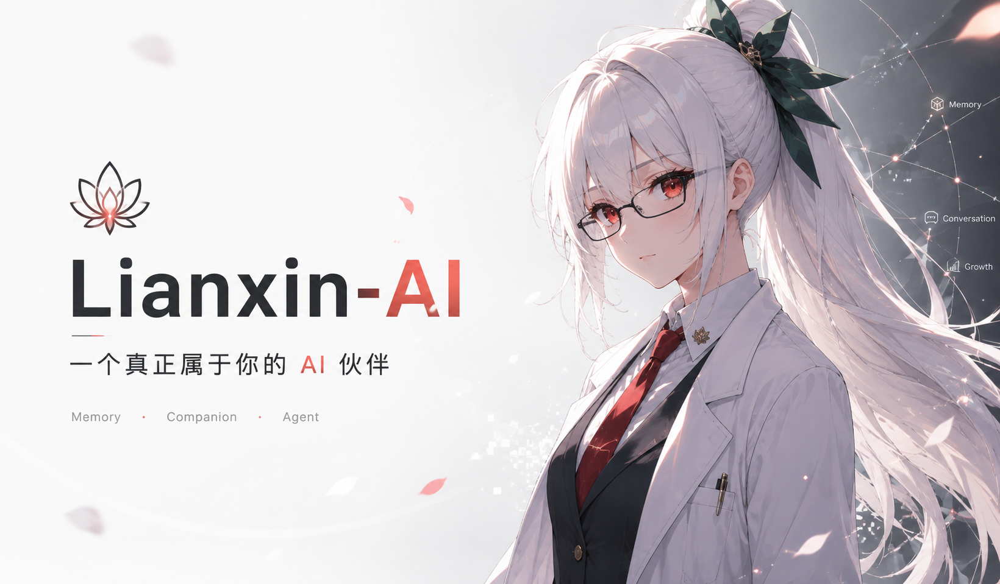
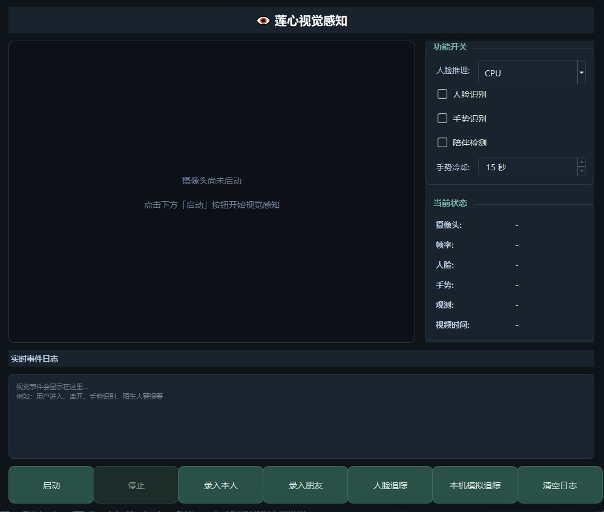
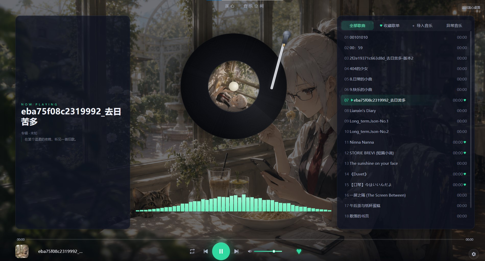
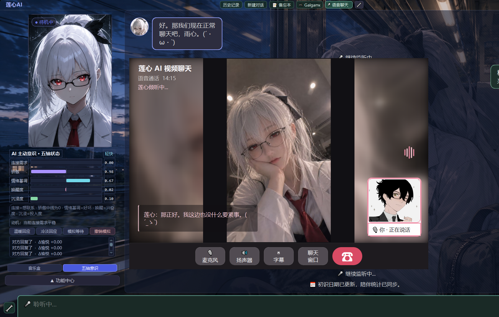
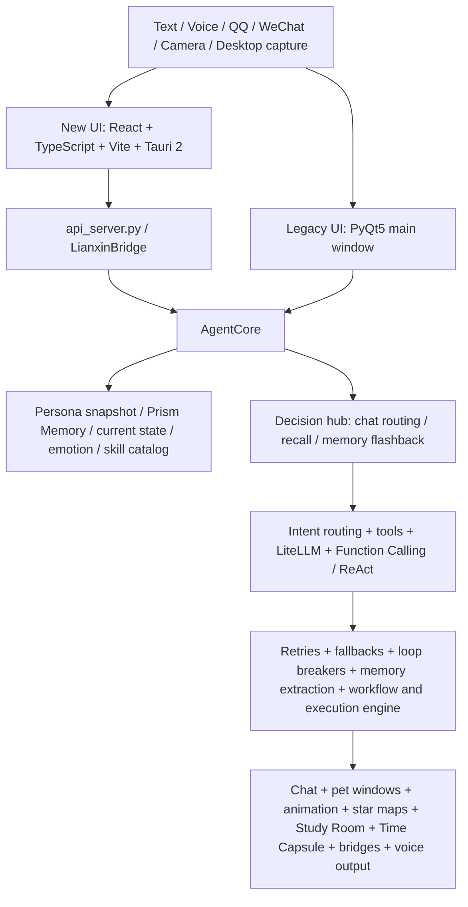
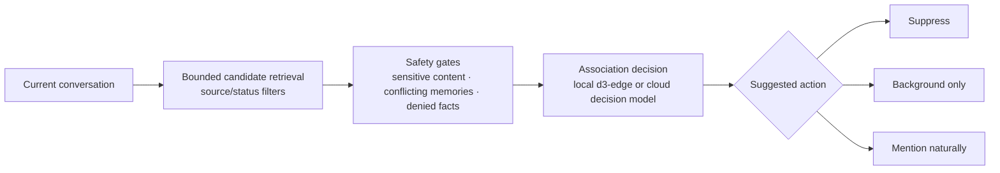

# Lianxin AI

> **Language / 语言:** English | [简体中文](README_CN.md)



<p align="center">
  
  
  
  
  
  
  
</p>

> A Windows desktop AI companion with persistent memory, emotional state, editable personas, and proactive behaviors.

It ships two desktop interfaces that share one Python core: the recommended **React + TypeScript + Vite + Tauri 2** interface under `frontend/`, backend-served by `api_server.py`, and the classic **PyQt5** interface. Both drive cloud or local LLMs through LiteLLM and use the same AgentCore, memory store, persona state, tools, and local configuration.

The project is inspired by the Endless Library setting from *Anomaly Handler*. It is designed as an AI character that can converse, remember, help with daily work, interact with local tools under permission boundaries, and reach users through optional QQ and WeChat bridges.

## Choose Your Language

| Documentation | Best for |
|---|---|
| **[English README](README.md)** | International users, contributors, and English-language setup instructions |
| **[Chinese README / README_CN.md](README_CN.md)** | Chinese product overview, memory/emotion/star-map documentation |
| **[Chinese advanced guide / README_CN_ADVANCED.md](README_CN_ADVANCED.md)** | Chinese deployment, configuration, proactive behavior, tools, extensions, and reference |

## Contents

- [Highlights](#highlights)
- [New Management Center](#new-management-center)
- [Feature Demonstrations](#feature-demonstrations)
- [Architecture](#architecture)
- [Core Systems](#core-systems)
- [Tools, Vision, and Voice](#tools-vision-and-voice)
- [Companion Modes and Hardware](#companion-modes-and-hardware)
- [Skills and MCP](#skills-and-mcp)
- [Resource Guidance](#resource-guidance)
- [Optional Integrations](#optional-integrations)
- [Quick Start](#quick-start)
- [Configuration](#configuration)
- [Project Layout](#project-layout)
- [Data and Privacy](#data-and-privacy)
- [Development](#development)
- [License and Assets](#license-and-assets)

## Highlights

| Area | What Lianxin AI provides |
|---|---|
| New UI | React + TypeScript + Vite + Tauri 2 shell with workspace navigation, chat area, companion rail, input bar, and a native management center |
| Management center | Native panels for alarms, proactive chat, capability hub, speech transcription, sound/network/global settings, API keys, QQ/WeChat chat, decision hub, and persona hub |
| Legacy UI | PyQt5 main window retaining the original star maps, prism memory, Study Room, Time Capsule, and global hotkey entry points |
| Conversational AI | Multi-turn chat, context compression, tool calling, retry handling, stale-response protection, and segmented replies |
| Model providers | DeepSeek, Agnes AI, OpenAI-compatible endpoints, and local Ollama models |
| Decision hub | Chat/agent routing plus recall and memory-flashback decisions, using a local `d3-edge` model or a cloud decision model with budget and fallback rules |
| Prism Memory | Categorized facts, a five-tuple knowledge graph, semantic retrieval, current state, and working memory |
| Memory flashback (瞬忆) | Surfaces relevant long-term memories the user did not explicitly ask for, then decides to suppress, keep as background, or mention naturally |
| Emotional continuity | Five affect axes plus a slower relationship layer (guardedness, trust, intimacy, rupture, repair) and relationship stages |
| Personas | Create, validate, preview, hot-activate, and switch persona profiles for new conversations |
| Shared growth | Evidence-based, revertible persona-growth events scoped to chat, proactive behavior, QQ, tree hole, Study Room, Time Capsule, or Bilibili comments |
| Proactive presence | Time-aware proactive chat, desktop observation, Bilibili browsing and interaction, idle activities, cooldowns, and pause controls |
| Study Room | A focus workspace with tasks, Pomodoro sessions, growth records, a yearly heatmap, wallpapers, and notes |
| Time Capsule | Shared journals, a timeline, anonymous messages, a collection space, migration of legacy diaries, and memory links |
| Data Tide | Coastal overview and achievements built from local conversation, music, and companion statistics |
| Alarms and reminders | Native management for alarms, countdowns, reminders, to-dos, and scheduled automation |
| Tools and media | Weather, files, browser automation, music, screenshots, camera input, OCR, image generation, speech, and OLED face preview |
| VisionLab | Face recognition and enrollment, OK/thumbs-up/wave gestures, presence and posture detection, with CPU/GPU switching |
| Voice stack | FunASR/Whisper/Volcano/Aliyun speech recognition, full-duplex interruption, Edge-TTS by default, and GPT-SoVITS fallback |
| Desktop pet and Live2D | Transparent Tauri windows with sprite poses, movement, in-window chat, voice, Live2D expressions, pinning, and resizing |
| Music Space | NetEase Cloud Music playback, playlists, lyrics, private roaming, local imports, and playback statistics |
| Bilibili | Interest-tagged recommendations, history feedback, main-account comment continuation, @ replies, notification polling, and test comments |
| Bridges | Optional QQ WebSocket and WeChat AstrBot integrations, managed from native QQ/WeChat chat panels |
| Automation | Natural-language scheduled tasks, workflow audit, a Codex-style execution engine with approvals, and ReAct tool execution |
| Extensions | Dynamically discovered Skills packages and MCP services, managed from the capability hub |


## New Management Center

The new UI's primary navigation contains **chat, music, Time Capsule, Prism Memory, and Study Room**. The management center opens settings and record panels as separate native windows or embedded pages, centralizing settings that previously lived in separate Qt dialogs. Most panels are native React windows backed by the same configuration and state as the legacy UI; the existing star-map, ripple, Data Tide, Study Room, and Time Capsule web pages are embedded through the backend. Entries not yet migrated, such as Prism Memory, still open the legacy Qt window.

| Group | Panels |
|---|---|
| Runtime and reminders | Alarms and reminders, proactive chat |
| Persona and relationship | Ripple emotion system, persona hub, star maps |
| Capabilities and perception | Capability hub, vision, speech transcription |
| System and connections | Sound settings, global settings, API keys, network settings, QQ chat, WeChat chat |
| Data and records | Data Tide |

- **Alarms and reminders** manages five areas: timed alarms, countdowns, reminders, to-dos, and automation, with repeat rules, missed-action handling, pause/resume, and run-now.
- **Proactive chat** controls normal proactive chat, playful observation, Bilibili surfing and interaction, idle activities, hourly weights, cooldowns, and debug actions.
- **Capability hub** shows the capability library, usage statistics, Skills, MCP services, plugin installation, and loading logs.
- **Persona hub** includes the growth timeline / shared growth center, where growth events can be accepted, reverted, or dismissed per evidence.
- **Decision hub** configures chat/agent routing, the local or cloud decision model used by recall and memory flashback, budgets, timeouts, and fallback.
- **QQ chat / WeChat chat** manage bridge connection, reply pacing, segmentation, rate limits, poke replies, voice replies, and cross-chat context.
- **History and notes** use the native History window and the legacy notes entry respectively, keeping the existing conversation and note storage.

## Feature Demonstrations

[Watch the Lianxin feature demonstration on Bilibili](https://www.bilibili.com/video/BV1BM3R61Ew4/?spm_id_from=333.1387.favlist.content.click)

The demonstration covers Lianxin's desktop interaction, visual perception, voice interaction, and companion behaviors.

### VisionLab



Lianxin can interact with you through an independent local vision module. It recognizes OK, thumbs-up, and waving gestures, identifies whether the person in the frame is the enrolled user, and measures how long you have been sitting at the desk. When appropriate, the companion can remind you to rest and move around. Face enrollment, gesture recognition, presence, posture detection, and CPU/GPU selection are available without sending every video frame to the LLM.

### Music Space



Music Space plays from NetEase Cloud Music as its primary source, with playlists, playback control, lyrics, synchronized state, and an ambient visual presentation. It also supports importing local music, and playback duration, feedback, and track history feed local statistics used by Data Tide and proactive behavior. Private roaming continues playback based on the current atmosphere.

### Desktop pet and Live2D

The new UI can open a transparent **desktop pet window** or a **Live2D window** from the main window. The pet supports idle, sit, sleep, happy, study, and think poses plus left/right movement; you can chat directly inside the window, use the action menu, mute, minimize, and pin it. The Live2D window supports model expressions, nodding/shaking, cursor following, and the same shared chat history. Both are independent Tauri WebViews that can be placed anywhere on the desktop. The legacy PyQt5 UI retains its Galgame window and `Ctrl+Alt+X` global hotkey.

### Video and voice calls



The video-call interface combines Lianxin's portrait/video, voice input, live subtitles, and speech output in one interaction window. It reuses the local speech-recognition, speech-synthesis, and full-duplex listening chain and can be enabled after configuring a local or cloud speech backend.

## Architecture



Both interfaces share the same backend and business core. The new UI reads and writes sessions, configuration, and runtime state through `api_server.py` HTTP and event endpoints; the legacy UI calls the same Python modules directly.

### Request lifecycle

1. A message enters from the desktop UI, voice input, or an enabled bridge.
2. `AgentCore` combines the active persona, relevant memory, current state, emotional context, and only the tools needed for the request.
3. The decision hub routes the turn: chat-only or full agent, with recall and memory-flashback decisions when applicable.
4. LiteLLM sends the request to the selected provider.
5. Tool calls are permission-checked, executed, recorded, and returned to the model when needed.
6. The response updates the UI and may update emotional state, memory, workflow, or task tracking.

## Core Systems

### Prism Memory

Prism Memory is a local, layered memory architecture rather than a single chat-history list.

- **Categorized factual memory** stores user facts and project knowledge with source and time metadata.
- **Five-tuple knowledge graph** tracks entities, relations, provenance, confidence, and temporal scope.
- **Semantic retrieval** can use local vector embeddings when the RAG dependency profile is installed.
- **Current state** holds short-lived, time-sensitive facts.
- **Working memory** preserves active topics and summaries during ongoing conversations.
- **Maintenance workers** consolidate candidates and retain traceable source information instead of silently replacing raw data.

### Memory flashback (瞬忆)

Memory flashback adds an active-association layer on top of storage and passive retrieval: when the user has not asked about the past, Lianxin can still search for potentially relevant long-term memories based on the current context and decide whether to bring one up.



- Only trustworthy, non-conflicting, non-sensitive candidates reach the decision step.
- The decision is not a command: Lianxin may still choose not to mention a retrieved memory.
- The **瞬忆 (memory flashback)** button in the input bar attempts one flashback for the next message only; it does not guarantee a match or a mention.
- A debug card in chat shows candidate count, decision model, suggested action, and whether any material was actually injected.

### Ripple Emotion System v3

The Ripple system models emotional continuity through slowly changing state variables instead of selecting a random mood for each reply. It maintains five fast affect axes plus a slower relationship layer.

| Axis | Variable | Range | Role |
|---|---|---|---|
| Connection need | `connection` | 0 → 1 | desire for companionship |
| Pride | `pride` | -1 ↔ 1 | relaxed/yielding vs proud/defensive |
| Valence | `valence` | -1 ↔ 1 | positive or negative tone |
| Arousal | `arousal` | -1 ↔ 1 | calm vs excited/tense |
| Immersion | `immersion` | 0 → 1 | engagement with the current topic |

The deeper relationship layer tracks **guardedness**, **trust**, **intimacy**, **rupture**, and **repair**. These change slowly over long interaction and produce the relationship stages `first meeting → acquaintance → friend → close friend → soulmate`. Event appraisal, persona bounds, cooldowns, decay, and history snapshots keep the state from jumping wildly.

Emotional state can inform tone, proactive motivation, and activity choice, but it cannot claim unverified facts, bypass a permission check, or alter persona identity.

### Persona Hub and Shared Growth

Persona Hub separates identity from state. A profile describes Lianxin's name, user form of address, style, relationship framing, and non-negotiable behavioral boundaries. Profiles support creation, editing, validation, preview, and hot activation; switching a profile changes the active snapshot for future turns without erasing factual history or granting new tool permissions.

The **shared growth** layer does not rewrite the persona's core text. It extracts evidence-backed preference events (reply length, structure, tone, teasing level, listening style, topic interests, proactive preference) and applies them as request-level dynamic context. Each event has a scene, confidence, risk level, and field diff; users can accept, revert, or dismiss it from the persona hub. Sensitive content, temporary emotions, and in-the-moment agreements are never promoted to permanent personality.

### Proactive Presence

Proactive behavior runs on an independent schedule and remains interruptible.

| Activity | Behavior |
|---|---|
| Proactive chat | Starts a context-aware conversation within configured time windows, probability, cooldown, and deduplication rules |
| Playful observation | Uses explicitly enabled desktop or camera observations as structured signals, not unrestricted surveillance |
| Bilibili interaction | Recommends videos from interest tags and search, and can reply to main-account comments, continue comment threads, and respond to @ mentions |
| Idle activity | Performs lightweight, scheduled activities when the user has been inactive: weather comments, diary review, chat history, local files, browser history, CPU/disk, recycle bin, anniversaries, and rest/hydration reminders |
| Test comments | Generates and edits Bilibili comment drafts; public posting only after explicit second confirmation |

The native proactive panel exposes all weights, cooldowns, observation devices, debug actions, Bilibili history/tag controls, and main-account authorization state. User messages take precedence, and pause controls, cooldowns, rate limits, and cancellation paths prevent background behavior from competing with an active conversation.

### Study Room and Time Capsule

The Study Room provides a focused, independent workspace with a task list, Pomodoro-style timer, immersive focus mode, growth records, annual heatmap, wallpapers, and companion notes. Its Python services communicate with the embedded HTML/CSS/JavaScript frontend through QWebChannel in the legacy UI; the new UI loads the same page through `/api/study-room/html` inside a Tauri iframe and does not require PyQtWebEngine.

Time Capsule offers paired journal pages, a time corridor, a private tree-hole space, collections, legacy-diary migration, and explicit links to long-term memory. The new UI can open the full page through `/api/time-capsule/html` and also provides a lightweight native workspace. Both keep their data locally.


Data Tide presents local interaction and growth history in a coastal overview and achievement list.


### Star Maps

The application contains two interactive, read-only visualizations.

- **Memory Star Map** shows memory objects, relations, source messages, timelines, and detail panels.
- **Ripple Star Map** shows current emotional state, important events, relationship signals, and historical snapshots.

Both are rendered with Canvas 2D. The new UI serves the same pages through `api_server.py` and embeds them in a Tauri iframe; the legacy UI uses Qt WebEngine and QWebChannel. A node can request a snapshot or open its source record, but browser-side views cannot directly modify memory.


## Tools, Vision, and Voice

### Decision hub

The decision hub is a routing and judgment layer, not a replacement LLM:

- **Chat routing** decides whether a message stays chat-only or enters the tool-enabled agent path (`auto`, `chat_only`, `force_agent`).
- **Recall and flashback decisions** judge whether a memory candidate is relevant and worth using.
- **Model choice** supports a local `d3-edge` server or a configured cloud model, sharing timeouts, budgets, and retry limits.
- **Safe fallback** keeps the original chat and memory chain working when the decision service is unavailable; authentication, quota, and parameter errors are not blindly retried.
- **Observability** exposes call status, candidate counts, suggested actions, and fallback reasons in the flashback card and decision panel.

### Workflows and long-task execution

- `workflows.db` records conversation and background-task runs, steps, artifacts, and reusable tool results for audit and recovery.
- The long-task execution engine uses a Codex-style panel: file changes, commands, and extra permissions appear as approval cards; users can accept, decline, stop, or steer a running task.
- Status, approvals, and stop results come from the real runtime. When confirmation is unavailable the UI reports unknown/offline instead of assuming success.
- Natural-language tasks are still parsed by the existing task parser and executed through the existing tools and permission boundaries.

### Tool layer

The tool layer includes weather, system information, files, browser actions, music control, notes, reminders, alarms, tasks, and Time Capsule operations. Calls pass through capability discovery, request policy, permission boundaries, execution logging, result handling, retries, and loop breakers.

### Vision

Visual capabilities include screenshots, camera input, OCR, image description, image generation, OLED face preview, and the independent VisionLab window. VisionLab supports face recognition and personal-feature matching, OK/thumbs-up/wave gestures, presence and posture detection, hot-swappable features, and CPU/GPU inference selection. Local event recognition can feed character animation, emotion, or proactive behavior without sending every video frame to a model.

### Voice

Voice capabilities include local FunASR and Whisper, plus Volcano and Aliyun cloud speech recognition with engine selection, auto-fallback, diagnostics, CPU/GPU selection, full-duplex listening and interruption, reference-audio transcription, Edge-TTS cloud voice by default, and automatic fallback to GPT-SoVITS v2/v3/v4 voice synthesis with emotion parameters and lazy model loading. QQ voice delivery may require FFmpeg to convert generated audio to SILK.

## Companion Modes and Hardware


Optional modes include the native desktop pet and Live2D windows, a legacy Galgame presentation, legacy desktop companion window states, standby voice companionship, shoulder-mounted camera control, ESP32-CAM video streaming, and face tracking with a local face box, error vector, and pan/tilt closed loop. Hardware and browser capabilities remain opt-in and are constrained by the same permission and safety layers as other tools.

The shoulder device can be observed and controlled through the Cloud Relay: photo capture, device status, temperature and humidity, pan/tilt commands, and the ESP32-CAM stream are exposed as separate capabilities. For same-network use, run `python tools/esp32_relay_server.py` locally and point the device at the computer's LAN address; the protocol is unchanged and no cloud relay is needed. Face tracking can run independently from the LLM after the stream is connected.

## Skills and MCP

Skills are pluggable capability packages. A skill normally contains a `SKILL.md` describing its knowledge and use boundaries together with tool definitions. The runtime discovers, registers, enables, disables, and progressively injects relevant skills so unrelated tool descriptions do not consume every request context.

Bundled skill packages include:

| Skill | Purpose |
|---|---|
| Voice synthesis | GPT-SoVITS multi-voice output with Edge-TTS fallback |
| Bilibili video summary | Video metadata, subtitle extraction, and structured summaries |
| Browser automation | Navigation, interaction, extraction, tabs, and screenshots |
| Web research | Search, source verification, reading, and browser hand-off |
| System information | Hardware and system status queries |
| Embodied simulation | Virtual-world tank navigation, turning, and status queries |
| Diary and notes | Time Capsule pages and note management (legacy tool names retained) |
| Music control | NetEase playback, private roaming, volume, and playlist queries |
| Shoulder peripherals | ESP32-CAM, pan/tilt servos, observation modes, and face tracking |
| Self knowledge | Authoritative description of Lianxin's own capabilities, architecture, and limits |
| GitHub (read-only) | Public repository search, README/file reading, and commit inspection |

MCP services expose additional tools through the same controlled workflow. The repository includes manifests for filesystem, Firecrawl, Tavily search, Zhihu search, and NetEase Cloud Music. Service availability, tool authorization, errors, and results remain visible to the request loop rather than becoming hidden model-side actions. The capability hub lets users inspect, enable, disable, test, and uninstall Skills/MCP services and review call statistics and logs.

## Resource Guidance

The base desktop profile is intended to run without a dedicated GPU when using a cloud text model. Install RAG, vision, voice, browser, and bridge packages only when needed. Local embedding models and local LLMs can increase memory, disk, CPU, and first-use download costs considerably.

For a stable lightweight setup:

1. Install `requirements.txt` (single categorized file; comment out optional sections for a lighter setup).
2. Use a configured cloud provider for the main conversation model.
3. Keep local vector retrieval, camera processing, voice engines, and local decision models disabled until required.
4. Enable one optional profile at a time and verify startup, chat, and logs before enabling another.

## Optional Integrations

| Integration | Purpose | Notes |
|---|---|---|
| Ollama | Local text models | Configure the provider as `local` and run Ollama separately |
| SiliconFlow | Visual understanding | Used for screenshot analysis and camera observation when configured |
| Agnes | Image generation | Uses a dedicated image key, falling back to the chat key when empty |
| Decision model | Chat routing, recall, flashback | Choose local `d3-edge` or a cloud model in the decision hub |
| Volcano / Aliyun STT | Cloud speech recognition | Select the engine and credentials in speech transcription settings |
| Edge-TTS / GPT-SoVITS | Speech output | Edge-TTS by default with optional GPT-SoVITS fallback; some QQ voice flows require FFmpeg |
| NetEase Cloud Music | Music playback | Start netease-music-mcp; the new UI probes and can launch it on demand |
| QQ bridge | QQ message access | Configure a WebSocket endpoint and owner account details |
| WeChat bridge | WeChat message access | Uses AstrBot integration |
| Playwright | Browser automation | Install Chromium after installing the browser dependency profile |
| MCP | Tool servers | Services are discovered and enabled through the extension system |

## Quick Start

### Requirements

- Windows 10 or 11
- Python 3.11 or 3.12
- At least one supported text-model provider

The new desktop interface in `frontend/` (React + TypeScript + Vite + Tauri 2) has its own system requirements:

- Node.js 18 or newer (bundles npm)
- The Rust toolchain from [rustup](https://rustup.rs/) — Tauri uses `cargo` to build the native window
- WebView2 Runtime, already present on most Windows 10/11 systems

It needs **no additional Python package**: its backend is `api_server.py` in the project root, which relies on the standard library plus modules already shipped in this repository.

The recommended first-run path creates a project-local virtual environment, installs the base desktop dependencies, and initializes user configuration under your home directory:

```powershell
.\bootstrap.bat
.\.venv\Scripts\activate
```

`bootstrap.bat` activates the virtual environment only for its own run; activate `.venv` in the new terminal before starting the backend.

### Launching the new UI

The new UI and the backend are separate processes. Start the backend first, then the desktop window.

Terminal 1 — project root:

```powershell
python api_server.py     # backend on http://127.0.0.1:8766
```

Terminal 2 — new UI:

```powershell
cd frontend
npm install              # first run only
npm run tauri dev        # new desktop window
```

Alternatively, run `frontend\start_ui.cmd`, which is equivalent to `npm run tauri dev`. If the backend is not running, the UI enters an offline mode and some pages (wallpapers, avatars, Study Room) may appear empty.

The previous `run.bat` one-click launcher has been removed; `run.python.txt` and `LIANXIN_PYTHON` are no longer used. Activate the desired Python environment in the backend terminal instead.

The legacy PyQt5 window is still available:

```powershell
conda create -n lianxin python=3.12
conda activate lianxin
pip install -r requirements.txt
python main.py
```

### Dependency Profiles

All dependencies live in the single `requirements.txt`, organized into labeled sections:

- **Core** – default desktop app, cloud chat, SQLite memory, Time Capsule, Study Room, and physical simulator
- **Vision** – camera, OCR, and visual processing
- **Voice** – local speech input and audio processing
- **RAG** – local semantic memory retrieval; installs PyTorch and downloads an embedding model on first use
- **Browser** – Playwright browser automation and web extraction
- **Bridge** – QQ / WeChat bridges and MCP integration
- **Dev** – development and CI tools

The Tauri interface requires **no extra Python package**: `requirements.txt` stays as-is. Only the system tools listed in [Quick Start](#quick-start) (Node.js, Rust, WebView2) are added on top.

```powershell
pip install -r requirements.txt
```

For a lighter install, copy `requirements.txt` and comment out the optional sections you do not need.

After installing the browser profile, install a browser binary:

```powershell
playwright install chromium
```

## Configuration

Configure a model from the settings UI after launch, or edit:

```text
%USERPROFILE%\.lianxin\user_config.json
```

Example for DeepSeek:

```json
{
  "deepseek": {
    "api_key": "YOUR_API_KEY",
    "base_url": "https://api.deepseek.com",
    "model": "deepseek-v4-flash",
    "provider": "deepseek"
  }
}
```

The application also supports Agnes AI and OpenAI-compatible endpoints through the configuration UI, plus Ollama via the `local` provider. Keep API keys, cookies, local databases, and logs out of version control.

The **decision hub** stores its cloud decision-model key separately, encrypted with Windows DPAPI at `%USERPROFILE%\.lianxin\decision_api_key.dpapi`. Without authorization for cloud context, it uses the configured local decision model or falls back to the original chain.

### Bridges and response delivery

QQ and WeChat bridges are optional. The native QQ/WeChat chat panels manage connection, reply pacing, voice replies, segmentation, rate limits, poke replies, and cross-chat context. Segmentation affects only outgoing Lianxin text; it does not alter model content or user-message merging.

## Project Layout

```text
Lianxin-AI/
├── main.py                 # Legacy PyQt5 entry point and startup checks
├── config.py               # Configuration and provider settings
├── api_server.py           # HTTP/JSON backend for the new UI
├── legacy_ui_launcher.py   # Opens legacy Qt windows on demand for the new UI
├── frontend/               # New React + TypeScript + Vite + Tauri 2 UI
│   ├── src/                # Main window, native panels, service layer
│   ├── src-tauri/          # Tauri 2 shell and window permissions
│   └── start_ui.cmd        # Starts the UI only (backend runs separately)
├── brain/                  # Agent, tools, memory, decision, emotion, personas, MCP
├── gui/                    # Legacy PyQt5 UI, web windows, Galgame/Live2D
├── workers/                # Background model, proactive, bridge, voice, maintenance workers
├── utils/                  # Schedulers, panel services, and shared utilities
├── skills/                 # Pluggable skill packages
├── mcp_servers/            # MCP service manifests
├── tools/                  # Development and hardware helper scripts
├── memory/                 # Conversations, memory, and emotion SQLite data
├── assets/                 # Visual and audio resources
├── docs/                   # Design, migration, and acceptance documents
├── tests/                  # Tests and acceptance scripts
├── logs/                   # Runtime logs
├── README.md               # English documentation (this file)
├── README_CN.md            # Chinese overview
└── README_CN_ADVANCED.md   # Chinese advanced guide
```

## Data and Privacy

| Data | Default location | Format |
|---|---|---|
| User configuration and global settings | `%USERPROFILE%\.lianxin\` | JSON |
| Conversations, memory, knowledge graph, emotion | `memory\conversations.db` | SQLite |
| Workflow and task runs | `%USERPROFILE%\.lianxin\workflows.db` | SQLite |
| Personas | `%USERPROFILE%\.lianxin\personas\` | JSON |
| Shared growth records | `%USERPROFILE%\.lianxin\persona_growth.db` | SQLite |
| Study Room records | `%USERPROFILE%\.lianxin\study_room.db` | SQLite |
| Time Capsule and legacy diaries | `%USERPROFILE%\.lianxin\time_capsule.db` | SQLite |
| Interaction events (music, companionship, achievements) | `%USERPROFILE%\.lianxin\interaction_events.db` | SQLite |
| Long-term fact cache | `%USERPROFILE%\.lianxin\long_term.json` | JSON |
| Alarms, reminders, and to-dos | `%USERPROFILE%\.lianxin\alarms.json` / `reminders.json` / `todo_ack.json` | JSON |
| Decision model API key | `%USERPROFILE%\.lianxin\decision_api_key.dpapi` | DPAPI-encrypted |
| Logs | `logs\` | Text files |

- Memory, emotion, persona, growth, and configuration data are stored locally and are not proactively uploaded.
- Conversation and memory databases live in the project's `memory\` directory; other user data lives under `%USERPROFILE%\.lianxin\`.
- Study Room, Time Capsule, shared growth, workflows, and decision credentials are stored separately and not mixed into chat context.
- Tool execution follows permission boundaries and is not intended to execute dangerous actions unconditionally.
- Memory writes retain source messages and time scope for review and auditing.

Read [PRIVACY.md](PRIVACY.md) for the complete privacy boundary.

## Development

Before opening a pull request or publishing a fork:

- Do not commit API keys, cookies, user configuration, local databases, or logs.
- Preserve existing permission checks and failure recovery when adding tools.
- Keep background work from blocking ordinary chat.
- Preserve memory provenance and time scope.
- Keep new UI panels as adapters over existing backend chains; do not reimplement Agent, memory, voice, or bridge logic in React.
- Test tool failure paths as well as success paths.

See [README_CN_ADVANCED.md](README_CN_ADVANCED.md) for the Chinese development checklist and full feature documentation.

## License and Assets

The source code is licensed under the [MIT License](LICENSE), subject to its copyright and notice requirements. The MIT license applies only to source code for which project maintainers hold the relevant rights. Third-party dependencies, music, sound effects, character assets, model weights, and other binary resources are not automatically licensed under MIT.

Read [ASSET_NOTICE.md](ASSET_NOTICE.md) for asset availability and additional conditions.

## Acknowledgements

- [LiteLLM](https://github.com/BerriAI/litellm) for unified LLM access
- [PyQt5](https://www.riverbankcomputing.com/software/pyqt/) for the legacy desktop UI
- [Tauri](https://tauri.app/) and [React](https://react.dev/) for the new desktop interface
- [AstrBot](https://github.com/AstrBotProject/AstrBot) for messaging-bridge support
- [SiliconFlow](https://siliconflow.cn/) for cloud visual APIs
- [GPT-SoVITS](https://github.com/RVC-Boss/GPT-SoVITS), [FunASR](https://github.com/modelscope/FunASR), and [Whisper](https://github.com/openai/whisper) for voice-related capabilities

## Disclaimer

This project is intended for learning, research, and personal use. Users are responsible for compliance with local law, third-party API terms, and platform rules. The project does not guarantee model output, external services, browser actions, or protection against user-data loss.


