# 莲心 AI

> **语言 / Language:** 简体中文 | [English](README.md)

> **继续阅读：** 本页介绍项目定位、新版管理中心、核心能力、记忆、情感与星图系统；[进阶功能、部署、配置与参考](README_CN_ADVANCED.md) 请见第二部分。

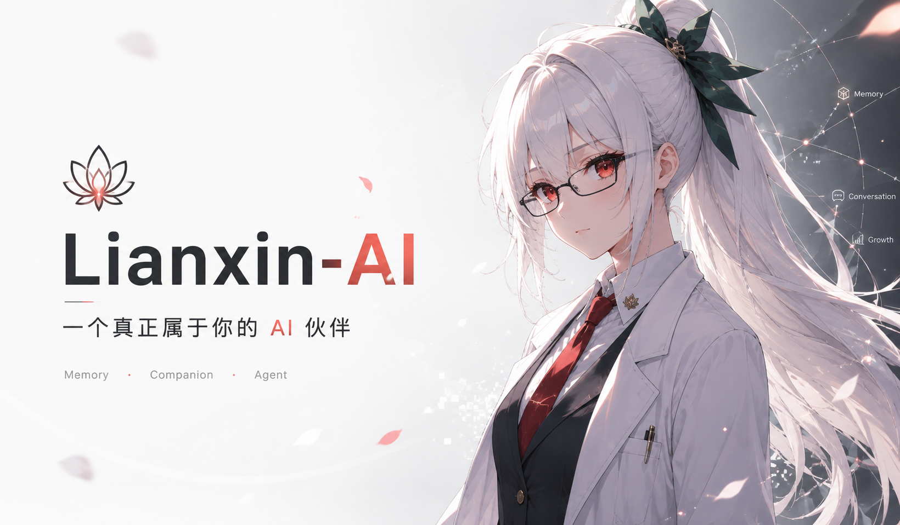

<p align="center">
  
  
  
  
  
  
  
  
</p>

> **一个拥有记忆、情感、人格与主动意识的 Windows 桌面 AI 伙伴。**

莲心来自《异象处理者》的无尽书馆设定。她像是从一座永远不会熄灯的书馆里走出来的管理员，带着白色书页、安静的灯光和一点不肯被遗忘的执拗，住进你的 Windows 桌面。

她会记住你反复提到的项目，会在你需要时处理文件、天气和系统信息，也会在长久沉默之后轻轻问一句"最近还好吗"。她不是把回答发送完就归零的程序，而是在每次对话、每次记忆和每次状态变化中，逐渐形成连续感的 AI 角色。

项目目前提供两套桌面界面：**新版界面（React + TypeScript + Vite + Tauri 2）**是推荐使用的主界面，管理中心的大部分设置与记录面板已迁移为原生 React 窗口；**旧版 PyQt5 主界面**继续保留，包含星图、棱镜记忆、自习室、时间胶囊等完整入口与桌面陪伴模式。两套界面共用同一套 Agent、记忆、情感、工具和本地数据。

---

## 目录

- [项目定位](#项目定位)
- [核心能力一览](#核心能力一览)
- [新版管理中心](#新版管理中心)
- [视觉、音乐与视频通话](#视觉音乐与视频通话)
- [系统架构](#系统架构)
- [棱镜记忆系统](#棱镜记忆系统)
- [涟漪情感系统](#涟漪情感系统)
- [星图系统](#星图系统)

进阶篇见 [人格枢控与共同成长、主动意识、自习室、时间胶囊、工具与桥接、扩展生态、安装配置、项目结构与隐私](README_CN_ADVANCED.md)。

---

## 项目定位

莲心 AI 是一个面向 **Windows 10/11** 的 Python 桌面 AI 伴侣项目，通过 **LiteLLM** 连接云端或本地大模型。它同时提供两套桌面界面：默认的**新版界面（React + TypeScript + Vite + Tauri 2）**，以及经典的 **PyQt5** 主界面。新版界面的后端接口由项目根目录的 `api_server.py` 提供；两套界面共享同一个 AgentCore、记忆库、情感状态和本地配置。

项目关注的不是单次问答，而是以下长期能力：

| 能力 | 说明 |
|------|------|
| 记忆可追溯 | 分类事实、知识图谱、向量检索、当前状态、工作记忆五层协同 |
| 记忆会联想 | 在用户没有主动提问时，瞬忆机制判断某段旧记忆是否值得自然提起 |
| 情感连续态 | 五轴动力变量缓慢变化，叠加信任、亲密、破裂与修复的关系层 |
| 人格可编辑 | 人格档案可创建、预览、校验、热激活和切换，成长轨迹可逐条采纳或撤销 |
| 主动行为 | 独立调度、冷却、暂停机制的主动聊天、观察、B 站冲浪与互动 |
| 工具安全 | 权限边界、错误恢复、日志记录、工作流审计和死循环熔断 |
| 状态可见 | 记忆星图、涟漪控制台、数据潮汐让内部状态可被理解 |

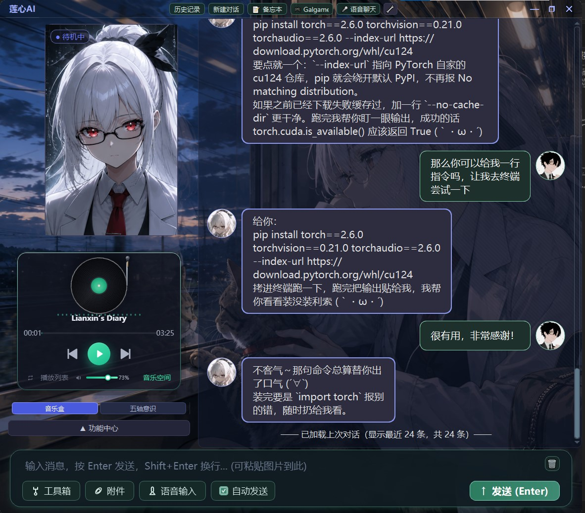

---

## 功能演示视频

[观看莲心功能演示视频（Bilibili）](https://www.bilibili.com/video/BV1BM3R61Ew4/?spm_id_from=333.1387.favlist.content.click)

视频中展示了莲心的桌面交互、视觉感知、语音和陪伴能力。完整的功能说明分布在中文概览与进阶篇中。

## 核心能力一览

| 功能域 | 核心能力 | 状态 |
|--------|----------|------|
| 新版界面 | React + TypeScript + Vite + Tauri 2 桌面壳：空间导航、对话区、伴随状态栏、输入区与管理中心 | 推荐使用 |
| 管理中心 | 闹钟与提醒、主动聊天、能力中枢、语音转录、声音/网络/全局设置、API Key、QQ/微信聊天、决策中枢、人格枢控等原生面板 | 核心可用 |
| 旧版界面 | PyQt5 主窗口，保留星图、棱镜记忆、自习室、时间胶囊等完整入口与全局热键 | 兼容保留 |
| 智能对话 | 多轮聊天、上下文压缩、工具调用、失败重试、回复保护、分段发送 | 核心可用 |
| 多模型支持 | DeepSeek、Agnes AI、OpenAI 兼容接口、Ollama 本地模型 | 可选配置 |
| 决策中枢 | 聊天/Agent 路由、回忆与瞬忆决策，支持本地 d3-edge 或云端决策模型，失败时保留原链路 | 核心可用 |
| 棱镜记忆 | 分类事实、五元组知识图谱、向量检索、当前状态、工作记忆 | 核心可用 |
| 瞬忆（记忆联想） | 用户未主动回忆时，按当前语境检索并判断是否自然提起；可抑制、仅作背景或轻提 | 核心可用 |
| 记忆星图 | 记忆对象、关系、来源消息、时间线和详情可视化 | 核心可用 |
| 涟漪情感 | 五轴状态、关系层（信任/亲密/破裂/修复）、事件原因、关系阶段、动机和历史快照 | 核心可用 |
| 人格枢控 | 人格档案编辑、预览、校验、热激活、新会话切换 | 核心可用 |
| 共同成长 | 从互动中提取成长事件，带证据、场景与风险等级，可采纳、撤销或忽略 | 核心可用 |
| 主动聊天 | 按时段/概率主动发起，支持暂停、冷却和去重；统一管理观察、B 站冲浪与摸鱼 | 核心可用 |
| 莲心自习室 | 独立专注空间、任务清单、番茄计时、成长统计、年度热力图、壁纸与留言 | 核心可用 |
| 时间胶囊 | 双页共同记录、时间长廊、树洞、收藏馆、旧日记无损迁移与长期记忆关联 | 核心可用 |
| 数据潮汐 | 对话、音乐、陪伴时长与成长记录的海岸概览和成就列表 | 核心可用 |
| 闹钟与提醒 | 定时闹钟、倒计时、提醒、待办与自动化任务的原生管理面板 | 核心可用 |
| 视觉理解 | 截图、摄像头、OCR、图片描述、图像生成、OLED 表情预览 | 可选配置 |
| VisionLab 视觉实验室 | 人脸识别与本人特征匹配、OK/大拇指/挥手识别、陪伴与姿态检测、CPU/GPU 切换 | 可选配置 |
| 语音交互 | FunASR / Whisper / 火山引擎 / 阿里云识别；全双工监听、打断、Edge-TTS、GPT-SoVITS | 可选配置 |
| 语音转录 | 识别引擎选择、自动降级、诊断、模型与设备设置的原生面板 | 可选配置 |
| 桌宠与 Live2D | 新版 Tauri 透明桌宠窗和 Live2D 窗：聊天、动作、语音、情绪表情、置顶与缩放 | 可选配置 |
| 视频语音通话 | 摄像头/立绘、实时字幕、语音输入与莲心语音输出的独立通话窗口 | 可选配置 |
| 音乐空间 | 网易云音乐播放、歌单、歌词、私人漫游、本地音乐导入与播放统计 | 可选配置 |
| B 站冲浪与互动 | 兴趣标签、主动推荐、主号评论续聊、@ 回复、通知轮询与测试评论 | 可选配置 |
| 工具箱 | 天气、系统信息、文件、浏览器、音乐、时间胶囊、备忘、任务 | 核心可用 |
| 外部桥接 | QQ WebSocket、微信 AstrBot、浏览器自动化 | 可选配置 |
| 扩展系统 | Skills 技能包和 MCP 服务动态发现、启用和停用 | 可选配置 |
| 任务自动化 | 自然语言解析任务、工作流审计、Codex 执行引擎与审批门禁 | 实验性 |
| 肩载设备 | ESP32-CAM 推流、拍照、状态、温湿度、云台控制与本人脸闭环追踪 | 可选配置 |


---

## 新版管理中心

新版界面左侧的一级空间导航包括**对话、音乐、时间胶囊、棱镜记忆系统和莲心自习室**；右侧管理中心的各个按钮会以独立窗口或内嵌页面打开设置与记录面板。大部分面板已经是原生 React 窗口，与后端保持同一份配置和状态；星图、涟漪情感、数据潮汐、自习室、时间胶囊等既有 Web 页面则通过后端内嵌展示，棱镜记忆等尚未迁移的入口仍会拉起旧版 Qt 窗口。

| 分组 | 面板 |
|------|------|
| 运行与提醒 | 闹钟与提醒、主动聊天 |
| 人格与关系 | 涟漪情感系统、人格枢控、星图系统 |
| 能力与感知 | 能力中枢、视觉理解、语音转录 |
| 系统与连接 | 声音设置、全局设置、API Key、网络设置、QQ 聊天、微信聊天 |
| 数据与记录 | 数据潮汐 |

其中：

- **闹钟与提醒**：定时闹钟、倒计时、提醒、待办和自动化任务五区管理，支持重复规则、错过处理、暂停/恢复与立即执行。
- **主动聊天**：统一管理普通主动聊天、调皮观察、B 站冲浪与互动、莲心摸鱼，以及各时段权重、冷却和调试动作。
- **能力中枢**：能力库、使用情况、Skills、MCP 服务、插件安装与加载日志。
- **人格枢控**：档案编辑之外新增「成长轨迹 / 共同成长中心」，成长事件可按证据逐条采纳、撤销或忽略。
- **决策中枢**：配置聊天/Agent 路由、回忆与瞬忆使用的本地或云端决策模型、预算、超时与降级策略。
- **QQ 聊天 / 微信聊天**：桥接连接、回复节奏、分段发送、限流风控、拍一拍、语音回复和跨端参考上下文。
- **历史记录 / 备忘本**：历史记录使用新版原生窗口，备忘本保留旧版入口；数据仍写入原有的会话与备忘存储。

---

## 视觉、音乐与视频通话

### 莲心视觉感知

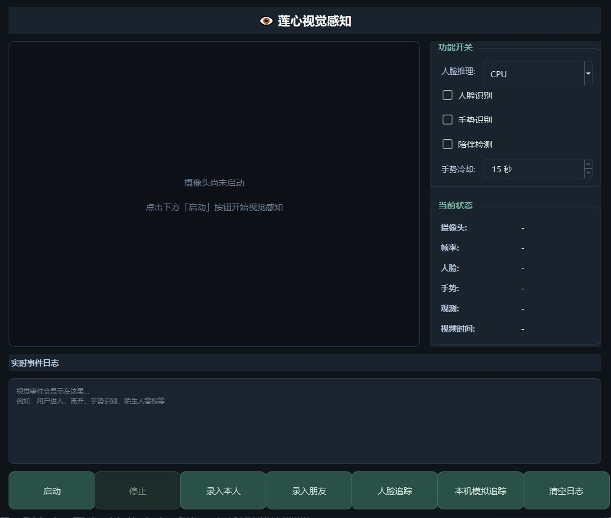

莲心可以通过独立的视觉感知模块与你进行更自然的互动。她可以识别 OK、大拇指、挥手等手势并做出反应，也可以识别画面中的人脸，判断屏幕中是否是已经录入特征的你。陪伴检测还能记录你坐在桌前陪伴她的时间，在适当时刻提醒你休息、活动和保护视力。

视觉模块支持人脸特征录入与匹配、手势识别、陪伴检测、姿态检测以及 CPU/GPU 推理切换。视觉事件在本地处理后可以驱动角色动画、情绪反馈或主动行为，不需要把每一帧摄像头画面都发送给大模型。

### 音乐空间

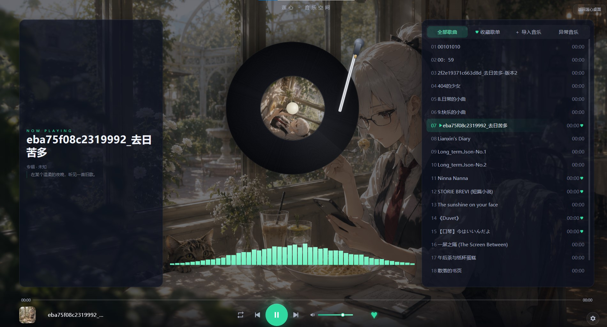

音乐空间是莲心独立的音乐界面，以**网易云音乐**为主要播放来源，支持歌单、播放控制、歌词、播放状态同步和空间化视觉呈现；也可以导入本地音乐并统一管理。私人漫游会根据当前氛围继续放歌，播放时长、曲目和反馈会写入本地统计，供数据潮汐和主动聊天参考。它和聊天、时间胶囊等模块保持相对独立，可以在陪伴、学习或休息时作为背景空间使用。

### 视频语音通话

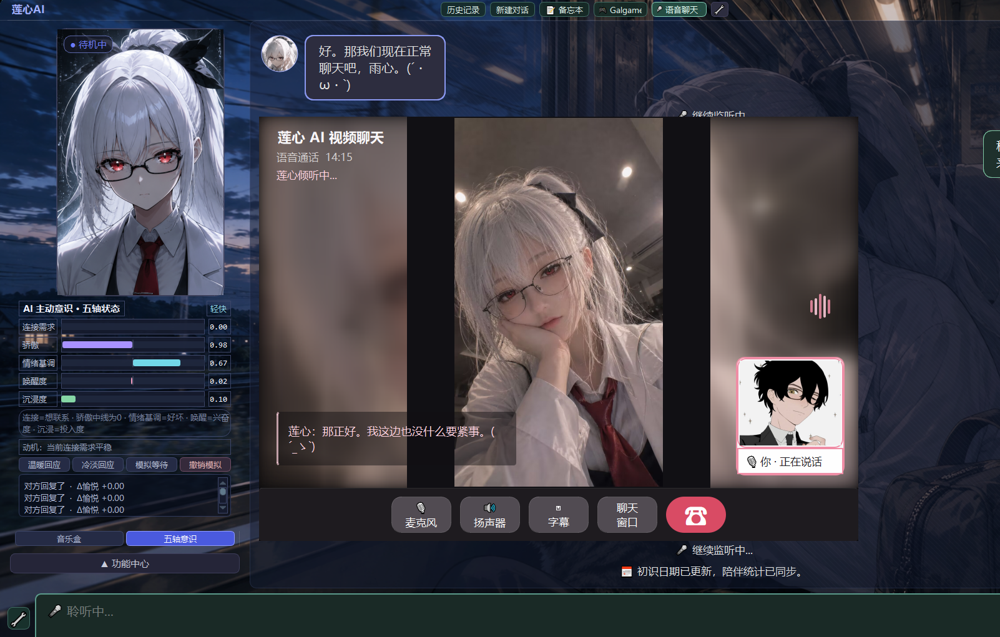

视频语音通话界面将莲心立绘/视频、语音输入、实时字幕和莲心的语音输出放在同一个交互窗口中。它复用了本地的语音识别、语音合成和全双工监听链路；在配置好本地或云端语音识别、语音合成后即可按需启用。

### 桌宠与 Live2D

新版界面可以从主窗口打开独立的**透明桌宠窗口**或 **Live2D 窗口**。桌宠支持待机、坐下、睡觉、开心、学习、思考等姿态与左右移动，也可以在窗口内直接聊天、使用动作菜单、静音、最小化和置顶；Live2D 窗支持模型表情、点头/摇头、鼠标跟随和与主界面共享的聊天记录。两个窗口都使用独立的 Tauri WebView，可以放在桌面任意位置。

旧版 PyQt5 界面仍保留 Galgame 立绘窗口与 `Ctrl+Alt+X` 全局热键，作为兼容入口。

## 系统架构

为避免中文全角字符在不同等宽字体中造成错位，架构关系采用 Mermaid 表达；下方文字说明保留了各层职责。

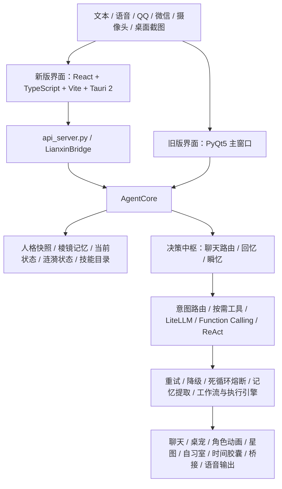

两套界面共用同一个后端和业务核心：新版界面通过 `api_server.py` 的 HTTP/事件接口读写会话、配置和运行状态；旧版界面直接调用同一组 Python 模块。

---

## 棱镜记忆系统

棱镜记忆系统不是简单的记忆列表，而是**多种记忆层协同工作**的本地记忆架构。

### 记忆系统全景图

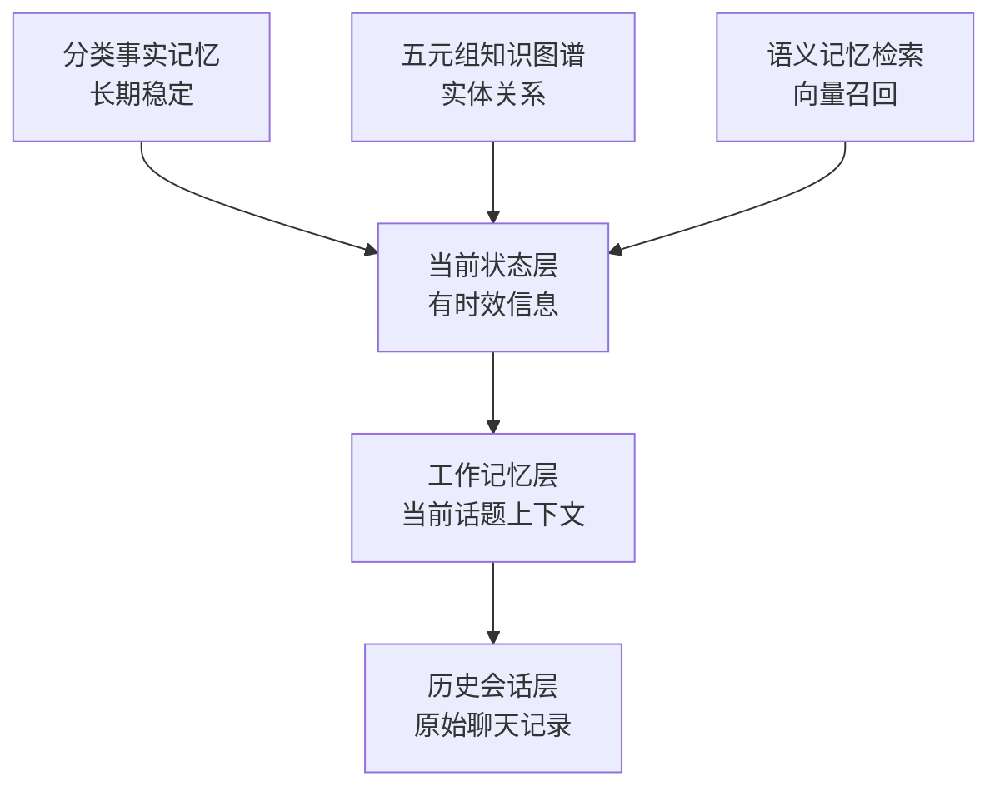

<!-- Legacy diagram removed: the Mermaid graph above avoids CJK width drift. -->
<!--
```text
┌─────────────────────────────────────────────────────────────┐
│                    记忆系统全景图                             │
│                                                             │
│  ┌──────────────┐  ┌──────────────┐  ┌──────────────┐      │
│  │ 分类事实记忆  │  │ 五元组知识图谱│  │ 语义记忆检索  │      │
│  │ (长期稳定)    │  │ (实体关系)    │  │ (向量召回)    │      │
│  └──────┬───────┘  └──────┬───────┘  └──────┬───────┘      │
│         │                 │                 │               │
│         ▼                 ▼                 ▼               │
│  ┌─────────────────────────────────────────────────────┐    │
│  │              当前状态层 (有时效信息)                  │    │
│  └─────────────────────────┬───────────────────────────┘    │
│                            │                                │
│                            ▼                                │
│  ┌───────────────────────────────────────────────────┐      │
│  │            工作记忆层 (当前话题上下文)              │      │
│  └───────────────────────────────────────────────────┘      │
│                                                             │
│  ┌───────────────────────────────────────────────────┐      │
│  │            历史会话层 (原始聊天记录)                │      │
│  └───────────────────────────────────────────────────┘      │
└─────────────────────────────────────────────────────────────┘
```
-->

### 六层记忆架构

| 层级 | 职责 | 生命周期 | 数据源 |
|------|------|----------|--------|
| **分类事实记忆** | 长期稳定事实：身份、职业、偏好、项目、技能 | 永久保存，用户可删除 | 自动提取 + 用户指令 |
| **五元组知识图谱** | 实体关系建模：人物、地点、组织、项目、事件 | 长期保存，随新信息增长 | 提取 + 用户确认 |
| **语义记忆检索** | 中文 embedding 向量索引，相似度 + 质量 + 时间召回 | 与事实记忆同步 | 向量数据库 |
| **当前状态** | 有时效信息：生病、短期计划、所在地 | 有过期时间，自动结束 | 对话 + 工具结果 |
| **工作记忆** | 当前话题、未闭环问题、临时任务摘要 | 短期保留，不升级为永久 | 对话上下文 |
| **历史会话** | 原始聊天记录，支持回顾和审计 | 永久保存 | 所有渠道消息 |

### 分类事实记忆

负责保存不应随上下文窗口消失的内容。事实分为**个人资料、偏好、事件、知识、行为和技能**等类别，并记录创建时间、更新时间、来源渠道、来源消息和证据片段。

- 支持用户明确纠正更新旧事实
- 发现矛盾内容时生成冲突候选，不直接覆盖
- 来源追溯可查看记忆来自哪次对话
- 用户可搜索、修改、删除和清理记忆

### 五元组知识图谱

将人物、地点、组织、项目、作品、兴趣和事件建模为可连接的实体，用**"主体—关系—客体"**保存结构化联系，并保留实体类型、关系来源和强度。

> 分类事实适合表达"用户是一名算法工程师"，图谱则适合表达"用户—参与—无人机基站巡检项目"、"项目—使用—视觉算法"等关联。模型可通过图谱做多跳关系探索，把分散在不同对话中的对象重新联系起来。

### 语义记忆检索

使用中文 embedding 建立向量索引，结合**相似度、记忆质量、更新时间、访问情况和证据数量**进行召回。即使用户换一种说法，也能找到语义相近的过往信息。

检索结果以"相关背景"形式注入当前请求，模型需要结合当前对话判断是否使用。RAG 只负责提供上下文，不绕过权限自动写入或删除记忆。

### 记忆联想（瞬忆）

瞬忆是在"存储 + 被动检索"之上增加的一层主动联想：当用户没有明确问起过去时，莲心也会根据当前语境寻找可能相关的长期记忆，再判断要不要提。

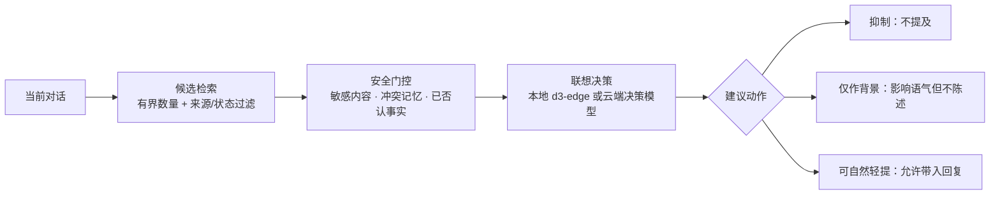

- 只有来源可信、未处于冲突、未标记敏感的候选才会进入决策；敏感信息默认不参与联想。
- 决策结果不是强制指令：即使检索到记忆，也可以选择完全不提。
- 聊天输入区的「瞬忆」按钮只让下一条消息尝试一次联想，不保证一定找到或提及记忆。
- 主聊天区会显示联想调试卡片，列出候选数量、决策模型、建议动作和实际注入情况，方便判断"她为什么突然想起了这件事"。

### 当前状态与工作记忆

- **当前状态**：保存有时效信息，记录有效期、置信度和状态事件，过期自动结束
- **工作记忆**：保存当前话题和临时任务，默认不升级为永久事实
- **历史会话**：聊天记录独立保存，可按关键词、时间范围和渠道回顾

### 记忆协调工作流程

#### 场景：用户说"我明天要去基站测试无人机"

```
1. 工作记忆层 → 记录当前话题：明天去基站测试无人机
2. 当前状态层 → 写入短期计划，设置有效期为明天晚上
3. 分类事实记忆 → 如无相关事实，可能触发提取
4. 知识图谱 → 如"基站"和"无人机"是新实体，创建节点并建立关系
5. 历史会话层 → 保存原始对话记录
```

#### 场景：用户说"记住，我喜欢听周杰伦的歌"

```
1. 用户指令优先 → 直接写入分类事实记忆（类别：偏好）
2. 知识图谱 → 如"周杰伦"不在图谱中，创建人物节点并建立关系
3. 语义记忆检索 → 为新事实生成 embedding 向量，加入索引
4. 当前状态层 → 不写入（这是长期偏好，不是短期状态）
```

### 记忆提取与写入流程

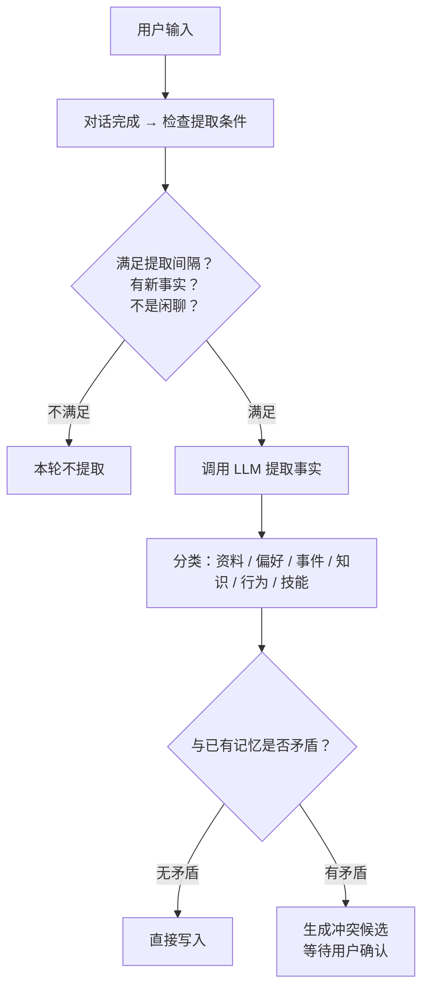

### 后台记忆维护

后台定期执行记忆维护任务，所有任务在独立线程运行，不阻塞正常聊天：

| 维护任务 | 说明 |
|----------|------|
| 记忆维护 | 清理低质量内容，补全来源信息 |
| 冲突扫描 | 发现矛盾的记忆候选 |
| 过期清理 | 结束过期的当前状态 |
| 来源补全 | 为缺少来源的记忆补充上下文 |
| 叙事整合 | 把零散事实整理成项目脉络和关系变化 |
| 质量评估 | 评估记忆质量，标记低置信度内容 |

**安全原则**：维护失败时保留原始记忆，不破坏已有数据；派生叙事可被重新生成，不取代原始证据；用户可在设置中关闭自动提取、调整间隔、暂停维护。

### 记忆系统分工总结

| 问题 | 由哪层回答 |
|------|-----------|
| 莲心长期记住什么？ | 分类事实记忆 + 知识图谱 |
| 事情之间如何联系？ | 五元组知识图谱 |
| 换种说法能找到吗？ | 语义记忆检索 |
| 莲心现在知道什么？ | 当前状态层 |
| 莲心正在聊什么？ | 工作记忆层 |
| 莲心和用户说过什么？ | 历史会话层 |

---

## 涟漪情感系统


涟漪情感系统 v3 是莲心的**连续状态层**，不是给回复贴"开心/难过"标签，而是维护一组受输入、活动、时间和长期关系缓慢影响的动力变量。

### 系统架构

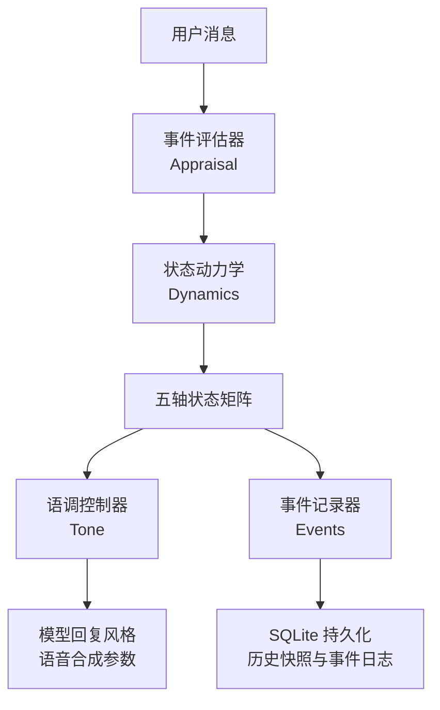

<!-- Legacy fixed-width diagram retained below for source history, hidden in rendered Markdown. -->
<!--
```text
┌─────────────────────────────────────────────────────────────┐
│                    涟漪情感系统 v3                            │
│                                                             │
│  用户消息 ──▶ ┌──────────────┐                              │
│               │  事件评估器   │  识别事件类型：温暖/冲突/     │
│               │  (Appraisal) │  道歉/离开/新计划/协作...     │
│               └──────┬───────┘                              │
│                      ▼                                      │
│               ┌──────────────┐                              │
│               │  状态动力学   │  单轮上限 · 事件冷却 ·        │
│               │  (Dynamics)  │  时间衰减 · 人格边界约束      │
│               └──────┬───────┘                              │
│                      ▼                                      │
│  ┌─────────────────────────────────────────────────────┐    │
│  │                  五 轴 状 态 矩 阵                    │    │
│  │                                                     │    │
│  │   连接需求  ▓▓▓▓▓▓▓▓░░  0.72                        │    │
│  │   沉浸度    ▓▓▓▓▓▓░░░░  0.58                        │    │
│  │   防御感    ░░░▓▓░░░░░  -0.15                       │    │
│  │   情绪基调  ░▓▓▓▓▓░░░░  +0.42                       │    │
│  │   唤醒度    ░░▓▓▓▓░░░░  +0.28                       │    │
│  └─────────────────────────┬───────────────────────────┘    │
│                            │                                │
│              ┌─────────────┴─────────────┐                  │
│              ▼                           ▼                  │
│     ┌──────────────┐           ┌──────────────┐            │
│     │  语调控制器   │           │  事件记录器   │            │
│     │   (Tone)     │           │  (Events)    │            │
│     │ 语气·温度    │           │ 原因·置信度  │            │
│     │ 活跃度·风格   │           │ 影响·方向    │            │
│     └──────┬───────┘           └──────┬───────┘            │
│            │                          │                    │
│            ▼                          ▼                    │
│     模型回复风格              SQLite 持久化存储             │
│     语音合成参数              历史快照 · 事件日志            │
└─────────────────────────────────────────────────────────────┘
```

-->

### 五轴状态详解


涟漪系统维护五个独立但互相影响的状态轴，每个轴有不同的变化速率和作用范围：

| 轴 | 变量 | 轴类型 | 低值 / 负端 | 基线 / 中值 | 高值 / 正端 |
|----|------|--------|------------|------------|------------|
| 连接需求 | `connection` | 单向轴（0 → 1） | 0.0 "保持距离" | 0.5 "正常互动" | 1.0 "渴望陪伴" |
| 骄傲 | `pride` | 中线轴（-1 ↔ 1） | -1.0 "放松、愿意服软" | 0.0 "平常心" | 1.0 "自尊、逞强、防备" |
| 情绪基调 | `valence` | 中线轴（-1 ↔ 1） | -1.0 "低落沮丧" | 0.0 "平静中性" | 1.0 "积极温暖" |
| 唤醒度 | `arousal` | 中线轴（-1 ↔ 1） | -1.0 "安静内敛" | 0.0 "正常活跃" | 1.0 "兴奋紧张" |
| 沉浸度 | `immersion` | 单向轴（0 → 1） | 0.0 "心不在焉" | 0.5 "专注话题" | 1.0 "深度投入" |

在五轴之外，涟漪 v3 还维护一组更慢的关系层变量：**防御感**（`guardedness`）、**信任**（`trust`）、**亲密**（`intimacy`）、**破裂**（`rupture`）和**修复**（`repair`）。它们不会被单轮对话轻易推满，而是随长期互动累积，并构成 `初见 → 相识 → 朋友 → 挚友 → 灵魂伴侣` 的关系阶段判断。

### 动力学机制

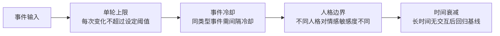

- **事件评估**：每轮交互前评估用户消息，识别事件类型并计算影响方向
- **状态衰减**：情感变量随时间缓慢衰减和恢复，不会永久停留在极端状态
- **事件冷却**：避免短时间频繁触发相同类型事件，防止状态剧烈波动
- **人格边界**：不同人格对情感变化的敏感度不同，冷静型人格抑制防御感，活泼型人格放大连接需求

### 情感系统联动图

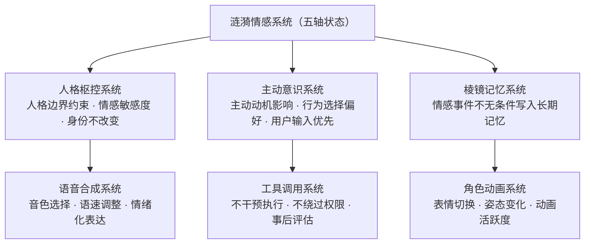

### 作用边界

涟漪情感会影响语气、回复温度、主动动机和活动选择，但**不会**：

- 代替事实记忆
- 改变当前人格身份
- 阻止正常工具调用
- 绕过权限、安全和隐私规则

### 涟漪控制台

控制台提供以下功能，帮助用户理解"为什么这次回复的语气发生了变化"：

- **当前快照**：实时查看五轴状态的当前值和可视化
- **历史快照**：追溯状态变化历史，观察衰减和恢复曲线
- **事件详情**：查看每次状态变化的原因、置信度和影响方向
- **输入与情绪变化链路**：理解输入如何一步步影响五轴状态
- **长期影响**：观察状态随时间的衰减和恢复趋势
- **回复指导**：了解当前状态如何影响表达风格和语气
- **模拟事件**：测试不同事件对状态的影响（不触发真实聊天）
- **状态恢复**：将状态恢复到某个历史快照

---

## 星图系统

星图系统是莲心的**可视化探索层**，将记忆对象、关系、情感状态和时间线映射为可交互的 Canvas 2D 星空视图。它不是新的数据存储层，而是让记忆和情感的内部状态变得**可被看见和理解**。

### 双星图架构

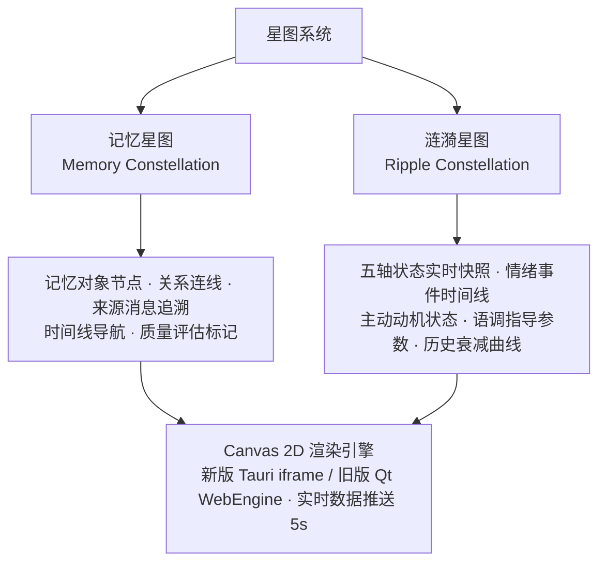

### 记忆星图


将棱镜记忆系统中的记忆对象映射为星空中的节点，关系映射为连线：

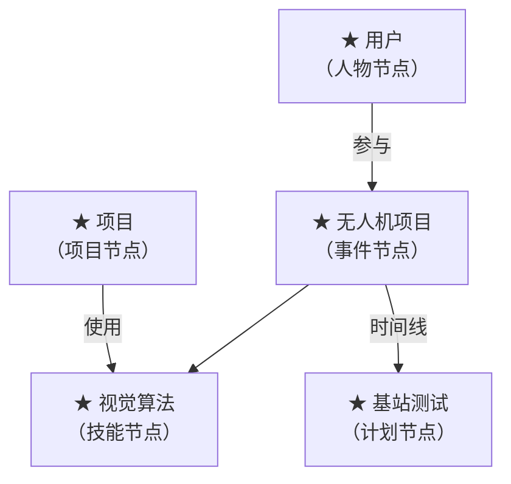

- **节点类型**：人物、地点、组织、项目、作品、兴趣、事件
- **关系连线**：主体—关系—客体，带方向箭头
- **来源追溯**：点击节点可查看来源消息原文
- **时间线导航**：按时间范围过滤记忆对象
- **质量标记**：低质量记忆有视觉标记，支持标记为待审核

### 涟漪星图


将涟漪情感系统的五轴状态、事件历史和主动动机实时映射为动态视图：

| 视图区域 | 显示内容（示意数据） |
|----------|----------------------|
| 五轴状态仪表盘 | 连接需求 0.72 · 骄傲 +0.15 · 情绪基调 +0.42 · 唤醒度 +0.28 · 沉浸度 0.58 |
| 情绪事件时间线 | 温暖回复（+5min）· 工作协作（+12min）· 新计划（+28min）· 长时间离开（+1h）· 冲突（+2h） |
| 主动动机状态 | 连接需求：高 · 适合主动：是 · 冷却中：否 |
| 语调指导参数 | 语气：温暖 · 温度：偏高 · 活跃度：中等 |

### 技术实现

| 组件 | 技术 | 说明 |
|------|------|------|
| 渲染引擎 | Canvas 2D | 高性能星空渲染，支持大量节点 |
| 嵌入方式 | 新版：`api_server.py` HTTP 页面 + Tauri iframe；旧版：PyQt5 WebEngine | 两套界面共用同一份页面资源 |
| 数据通信 | 新版：HTTP 快照接口与窗口消息；旧版：QWebChannel | Python ↔ JavaScript 双向通信 |
| 数据推送 | 5 秒定时刷新 | 涟漪星图每 5 秒推送最新快照 |
| 全屏切换 | 宿主窗口控制 | 支持全屏查看，权限受控 |
| 来源追溯 | SQLite 查询 | 点击节点弹出原始消息对话框 |

### 安全设计

- **只读桥接**：星图页面不能直接修改记忆，只能通过 Python 层请求快照
- **权限控制**：全屏查看等操作受宿主窗口权限约束
- **审核标记**：支持将记忆标记为"待确认"，不直接删除
- **容错处理**：原始消息不存在时显示友好提示

---

## 继续阅读

中文 README 已按 GitHub 的文件预览大小限制拆分。请继续阅读 [进阶功能、部署、配置与参考](README_CN_ADVANCED.md)，其中包括人格枢控与共同成长、主动意识、自习室、时间胶囊、工具与桥接、扩展生态、安装、配置、项目结构、隐私、许可证、测试和致谢。
---
