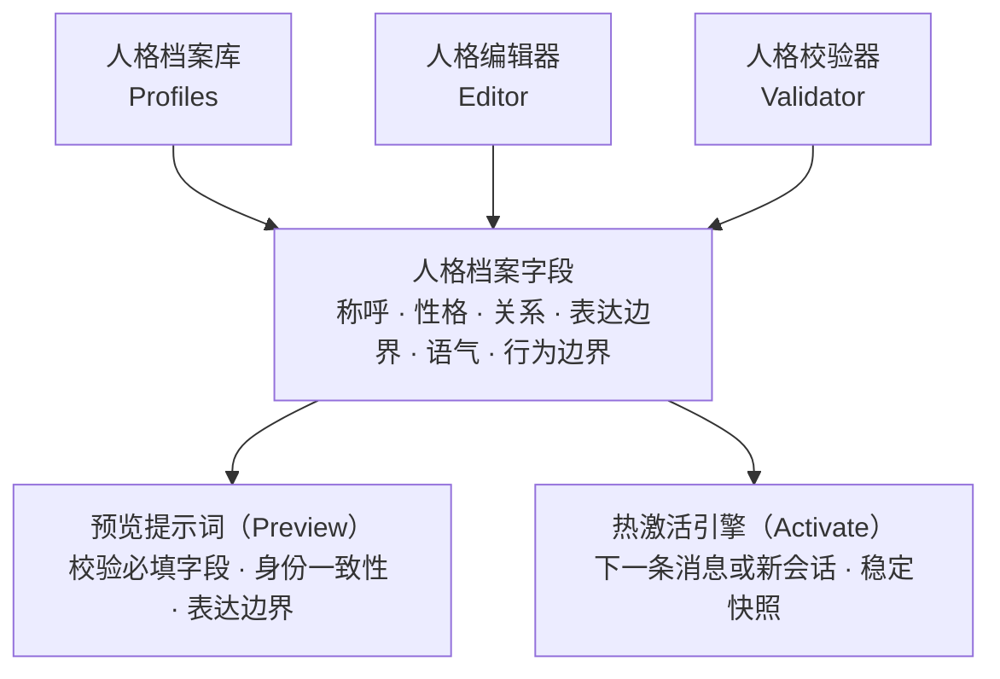
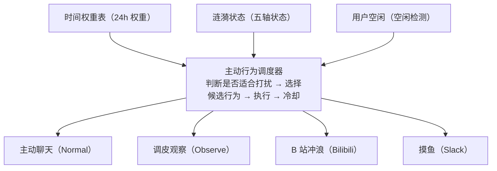
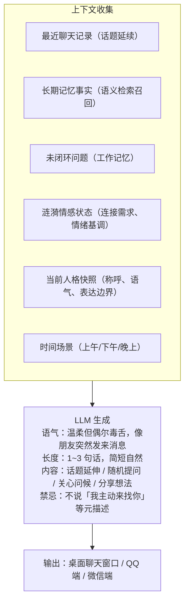
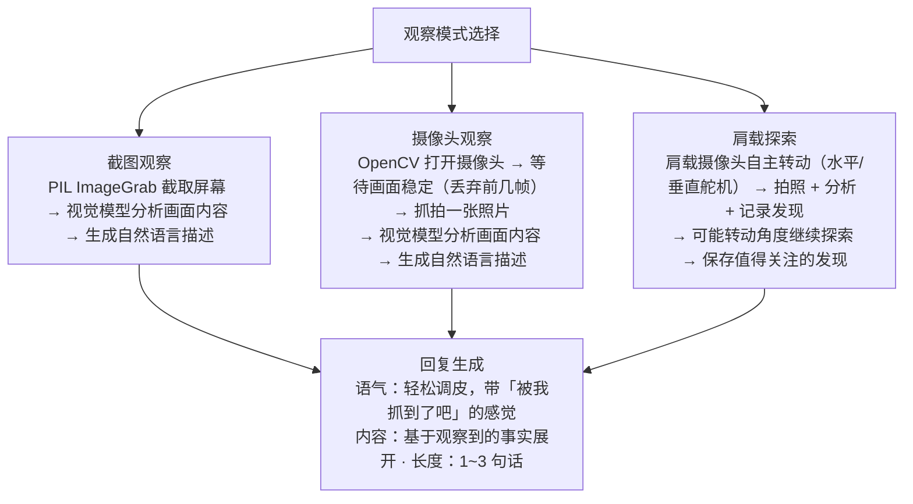
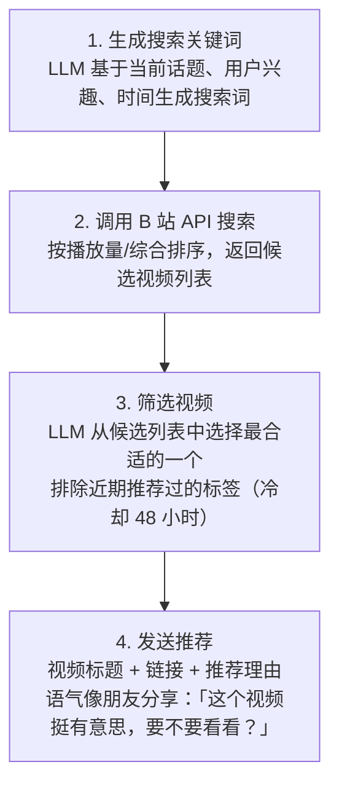
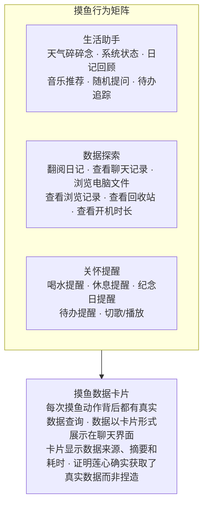
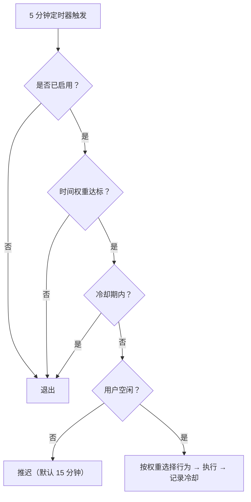
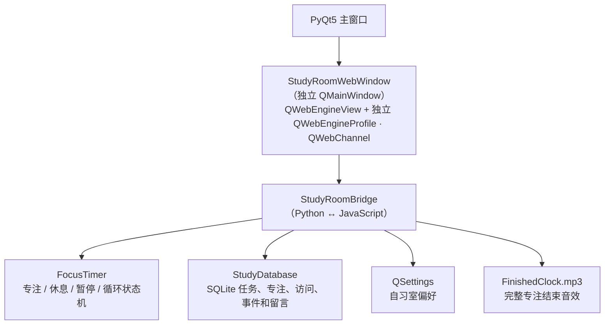

# 莲心 AI：进阶功能、部署与参考

> [返回中文概览](README_CN.md) | [English](README.md)

## 人格枢控系统

人格枢控系统让莲心的**"身份"和"状态"分离管理**。人格档案描述她是谁、如何称呼用户、如何表达以及哪些行为边界不可越过；记忆和情感状态由独立的运行时层维护。

### 架构设计



### 功能特性

- 创建和编辑人格档案
- 设置称呼、性格、关系、表达边界和语气
- 预览人格提示词并校验字段
- 保存并热激活人格
- 选择从下一条消息生效，或新建干净会话

每次请求使用稳定的人格快照，避免在工具调用过程中途改变身份。激活前的预览和校验用于检查必填字段、身份一致性和表达边界。

### 共同成长

共同成长层不改写人格档案的核心文本，而是把从长期互动中提取的表达偏好，作为请求级动态上下文叠加。每条成长记录包含来源证据、场景、置信度、风险等级和具体字段变更；用户可以在人格枢控的「成长轨迹 / 共同成长中心」中逐条采纳、撤销或忽略。

| 类型 | 内容 |
|------|------|
| 可成长字段 | 回复长度、回复结构、互动语气、调侃程度、倾听方式、话题兴趣、主动偏好、事实核验习惯 |
| 作用场景 | 所有场景、主聊天、QQ 聊天、主动陪伴、树洞、自习室、时间胶囊、B 站公开评论 |
| 安全边界 | 只允许低风险项进入候选；敏感内容、临时情绪、本轮约定不会被固化 |
| 可回滚 | 每条记录保留证据和版本，可撤销；原始人格文本始终保留 |

真实性要求（例如"未知事实先核验"）属于基础规则，不依赖成长开关，也不会被成长记录关闭。

---

## AI 主动意识

莲心的主动行为不是简单的定时器，而是由**主动行为调度器、涟漪状态、当前话题、用户空闲时间、冷却规则和后台职责**共同决定的智能系统。

### 系统架构



### 行为权重与调度

调度器维护四种行为的权重和冷却时间，每次触发时按权重随机选择一种行为：

| 行为 | 默认权重 | 冷却时间 | 说明 |
|------|----------|----------|------|
| 主动聊天 | 30 | 30 分钟 | 基于话题、记忆和状态发起对话 |
| 调皮观察 | 25 | 60 分钟 | 截图或摄像头观察桌面环境 |
| B 站冲浪 | 20 | 180 分钟 | 搜索并推荐 B 站视频 |
| 摸鱼 | 25 | 45 分钟 | 天气、日记、系统状态、提醒等 |

### 主动聊天

主动聊天是莲心最核心的主动行为，不是机械地"到点发消息"，而是基于多种上下文自然延伸：



**触发条件**：
- 时间权重达标（深夜不发，晚上权重最高）
- 用户空闲超过设定时间
- 不在冷却期内
- 情感系统允许主动行为

**时间权重分布**：

| 小时 | 00-07 | 08 | 09-11 | 12-13 | 14-16 | 17-18 | 19-22 | 23 |
|------|-------|----|----|----|----|----|----|----|
| 权重 | 0（深夜不发） | 4 | 6（上午提高权重） | 5（午休） | 6（下午） | 5（傍晚） | 8（晚上高权重） | 4 |

### 调皮观察

莲心会偷偷"看"你一眼，然后基于看到的内容发消息，带一点"被我抓到了吧"的感觉。



**观察数据源**：
- 屏幕截图：当前桌面画面
- 摄像头：用户状态、桌面环境
- 肩载摄像头：自主探索周围环境，可转动舵机调整视角

### B 站冲浪

莲心会像朋友一样给你推荐 B 站视频，不是随机链接，而是基于标签和搜索的真实推荐。



新版面板把这套流程扩展成两类能力：

- **冲浪侧**：兴趣标签增改/暂停/删除、搜索词与意图备注、浏览历史、近 48 小时去重、喜欢/不喜欢反馈，以及手动触发一次冲浪用于调试。
- **互动侧**：主号 UID 查询与确认、自动回复我的 B 站留言、评论区 `@` 莲心时回复、通知优先轮询、测试视频查询、评论草稿生成/编辑/保存/清除。测试评论只有在二次确认后才会公开发送，记录可回看、可点赞/点踩、可打开原视频。

### 摸鱼行为

摸鱼是莲心最丰富的主动行为集合，包含多种数据来源和互动方式。



**摸鱼数据源清单**：

| 数据源 | 说明 | 卡片展示 |
|--------|------|----------|
| 天气查询 | 获取当地天气信息 | 温度、天气状况 |
| 翻阅日记 | 查看今天或过去的日记记录 | 日记摘要 |
| 查看聊天记录 | 搜索历史聊天内容 | 相关聊天片段 |
| 浏览电脑文件 | 随机读取桌面/文档中的 txt/md/docx/pdf | 文件片段 |
| 查看浏览记录 | 获取浏览器历史记录 | 最近访问的网页 |
| 查看系统状态 | CPU、内存、磁盘、开机时长 | 系统运行状态 |
| 查看回收站 | 检查回收站内容 | 被删除的文件 |
| 查看相识纪念日 | 检查是否有即将到来的纪念日 | 纪念日提醒 |
| 查看当前播放 | 获取网易云音乐当前播放状态 | 歌曲信息 |
| 喝水/休息提醒 | 定时提醒用户喝水和休息 | 关怀提醒 |

### 调度机制



> 用户输入始终优先，自动让路。

### 原生主动聊天面板

新版界面「管理中心 → 主动聊天」把这套调度系统做成独立原生面板，包含五个区域：

- **总体调度**：桌面主动聊天、音乐反馈、QQ 主动消息、频率、最小间隔、用户延后、记忆驱动关怀与记忆评估间隔；四类行为权重和冷却不能同时为 0，支持恢复默认。
- **普通聊天 / 调皮观察**：普通主动聊天开关，截图概率、摄像头概率、等待时间与设备选择，观察结果是否发 QQ，以及截图/摄像头观察调试。
- **B 站冲浪与互动**：兴趣标签增改/暂停/删除、搜索词与意图备注、冲浪调试、浏览历史与喜欢/不喜欢反馈；主号互动、自动回复、@ 回复、测试评论草稿与二次确认公开发送。
- **莲心摸鱼**：后续笔迹、重温书页、搜索旧话题、提醒待办、随机提问、天气碎碎念、读本地文件、浏览器历史、CPU/磁盘、回收站、休息/喝水提醒、纪念日、切歌/放歌等独立开关与调试动作。
- **运行状态**：当前启用行为、冷却、最近行为、失败回退与暂停/恢复。

所有面板动作复用原有的调度器、执行器和记录，不在前端另造一套任务链路。用户输入始终优先，自动让路。

---

## 莲心自习室


莲心自习室是一个独立的生活场景模块，不是聊天页中的普通番茄钟。它把“选择一个目标、完成一段专注、记录真实过程、回看长期积累”组织成一个有温度的私人学习空间。

### 产品体验

自习室的体验顺序是：

1. 选择一个任务或常用专注时长；
2. 进入首页或沉浸专注页面开始倒计时；
3. 莲心通过简短陪伴文案和安静的视觉空间陪用户完成这一段；
4. 完成、暂停、中断和房间访问被分别记录；
5. 用户在成长记录、时间回溯、莲心留言和本周足迹中看到自己的积累。

自习室数据属于独立本地子系统，不会自动写入聊天历史、棱镜长期记忆或涟漪情感事件。

### 技术架构



前端资源位于 `gui/study_room/web/`：

- `index.html`：页面语义结构和六个视图容器；
- `app.js`：前端状态、QWebChannel 调用、页面切换和局部渲染；
- `styles.css`：温暖书房视觉、响应式布局、沉浸页面和性能规则。

新版界面通过 `api_server.py` 的 `/api/study-room/html` 在 Tauri iframe 中加载同一套页面，不需要加载 PyQtWebEngine；旧版 PyQt5 界面仍使用 Qt WebEngine 窗口和 QWebChannel 通信。两种承载方式共用同一个 `StudyDatabase` 与专注状态机。

窗口使用独立 WebEngine Profile，页面通过本地文件加载，并使用版本查询参数避免旧 CSS/JS 缓存。窗口关闭时会释放 WebEngine、Qt 定时器和房间访问记录，避免反复打开自习室后逐渐卡顿。

### 界面布局

左侧固定栏包含：开始专注、任务清单、成长记录、我的空间和设置，底部显示时间、日期、星期和农历。右侧主区域包含顶部栏目和当前视图。普通页面使用奶油色、浅咖啡和木色；沉浸专注页面切换为深棕色背景，隐藏侧栏和普通顶部栏，只保留大号倒计时、任务和控制按钮。

### 开始专注与沉浸专注

首页从上到下显示问候语、今日目标、SVG 圆形倒计时、常用时长、任务选择器、开始按钮和莲心陪伴卡片。当前预设为标准 25/5、深度 50/10、长时 90/15；选择任务后，任务自己的时长优先于预设。

开始专注后可以自动进入全屏沉浸页面，也可以手动进入。沉浸页面包含莲心陪伴徽章、大号渐变 SVG 倒计时环、当前任务、暂停/结束/返回按钮和阶段文案。倒计时由 Python 后端负责，前端只负责显示；完整结束播放 `assets/sound/FinishedClock.mp3`，手动结束则保存为中断记录。

### 任务清单

任务创建行统一为：

```text
任务名称 | 专注（分钟） | 休息（分钟） | 循环 | 添加任务
```

支持搜索、全部/未完成/已完成筛选、勾选完成、删除和右键编辑。编辑对话框可以修改名称、专注时长、休息时长和循环配置。任务时长后端限制为 1~600 分钟，休息时长限制为 0~60 分钟。

### 成长记录

成长记录提供今天、本周、本月、本年的范围切换，并展示当前范围专注时长、连续努力天数、完成专注次数、中断专注次数、自习室打开时长、本周一至周日趋势柱状图和最近 8 条完成/中断记录。周趋势纵轴会根据最高专注量自动选择分钟或小时刻度，柱体从横轴底部向上增长。

#### 时间回溯

时间回溯仿照 GitHub 贡献记录板，显示过去一年按自然周对齐的 `53 × 7 = 371` 个日期格。浅色代表没有专注，咖啡色按单日专注时长分级，当前日期使用金色描边，未来日期降低透明度；月份标签按周列定位，跨月时不会被 Grid 挤到隐藏行。

悬停只显示一个自定义咖啡色提示卡，包含日期、专注时长、完成次数和中断次数，不设置原生 `title`，避免 WebEngine 产生黑色系统提示和闪烁。底部显示最近一年完成次数、最长连续专注和当前连续专注；单日累计不少于 5 分钟才算活跃日。

### 我的空间

我的空间包括自习室壁纸、莲心留言和本周足迹三个部分。壁纸扫描 `assets/自习室`，支持默认壁纸、本地自定义壁纸、横向预览、填满裁切/完整显示、壁纸透明度和内容遮罩调节，预览图采用延迟加载。每次完整专注后生成一张本地鼓励纸条，支持点赞、收藏和收起；本周足迹记录任务和专注事件。

### 设置

设置提供默认专注时长、默认休息时长、完成后进入休息、专注时自动全屏、显示完成反馈和启用界面动画。设置保存在 QSettings，只影响之后新开始的专注；关闭界面动画可减少低性能设备上的动效开销。

### 本地数据

数据库默认位于 `%USERPROFILE%/.lianxin/study_room.db`，主要表为：

| 表 | 作用 |
|---|---|
| `study_tasks` | 任务名称、时长、休息、循环和完成状态 |
| `focus_sessions` | 每次专注的开始、结束、实际秒数和完成/中断状态 |
| `room_visits` | 自习室窗口访问区间，统计打开时长并合并重叠区间 |
| `study_events` | 任务和专注事件足迹 |
| `companion_notes` | 完成专注后的莲心留言和互动状态 |

### 性能与边界

成长统计只在成长记录可见时每 60 秒刷新，离开页面立即停止；热力图数据未变化时复用已有格子；倒计时每秒只更新当前可见圆环；壁纸预览异步解码；关闭窗口会释放旧 WebEngine 和定时器。自习室不自动调用 LLM，不把专注数据写入长期记忆。

## 时间胶囊


时间胶囊把旧“日记本”改造成用户与莲心共同使用的本地记忆空间。它不是单向的模型总结列表：用户写左页，莲心根据当天共同对话留下右页；封存后仍可追加“笔迹”，也可以把图片、音乐、文件、自习、游戏、聊天和地点作为共同收藏附在当天。

界面由四个部分组成：

- **今天**：双页记录、自动保存、后续笔迹、共同收藏和手动封存；
- **时间长廊**：过去一年的 `53 × 7` 活跃热力图、连续记录、最近收藏与按月时间线；
- **树洞**：不要求标题和解释的独立纸条，可收藏重要回声；
- **收藏馆**：把已封存日期整理成可重访的回忆册，并可邀请莲心通过本地 RAG 寻找相关长期记忆一起回看。

技术链路为 `TimeCapsuleWindow → QWebChannel → TimeCapsuleBridge → TimeCapsuleDatabase`。数据库默认位于 `%USERPROFILE%/.lianxin/time_capsule.db`，旧 `memory/diary.db` 与 `%USERPROFILE%/.lianxin/diary.db` 只读迁移，原文件不会删除或修改，迁移标记保证重复启动不会反复导入。新版界面同样通过 `/api/time-capsule/html` 在 Tauri iframe 中打开这份页面，并额外提供轻量的原生时间胶囊工作区。

只有用户明确点击“封存今天”时，该日内容才会在后台关联到长期记忆；普通编辑、树洞纸条和未封存书页不会自动进入棱镜记忆。收藏馆的相关回忆检索不调用聊天模型，因此不会产生额外生成 Token。


## 数据潮汐与成就记录

数据潮汐以轻量化统计呈现与莲心的陪伴轨迹，包括对话、互动和陪伴时长趋势；成就记录将这些日常片段整理为可浏览的贝壳收藏，不把陪伴变成打卡压力。


## 工具、视觉与语音

### 决策中枢

决策中枢是莲心的路由与判断层，不是新的大模型替代品：

- **聊天路由**：决定一条消息走纯聊天，还是进入带工具的 Agent 链路。支持 `auto`、`chat_only`、`force_agent` 三种模式。
- **回忆决策**：在人物回忆、证据核验和瞬忆链路中判断候选是否相关、是否值得使用。
- **模型选择**：可使用本地 `d3-edge` 模型，也可以配置云端决策模型；两者共享超时、预算和重试额度。
- **失败降级**：决策服务不可用时保留原有聊天与记忆链路，不因决策失败阻塞正常回复；认证、配额和参数错误不会盲目重试。
- **可观测**：聊天区的瞬忆卡片和决策面板会显示调用状态、候选数量、建议动作和回退原因。

### 工作流与长任务执行

- `workflow.db` 记录会话与后台任务的运行、步骤、产物和工具结果缓存，便于审计和恢复。
- 长任务执行引擎采用 Codex 风格的执行面板：文件改动、执行命令和额外权限会以审批卡片呈现，用户可以批准、拒绝、停止或在执行中补充要求。
- 任务状态、审批结果和停止请求都以真实运行时状态为准；无法确认时显示"未知/离线"，不会假设成功。
- 自然语言任务仍由自动任务解析器生成，执行器复用既有工具和权限边界。

### 工具能力

莲心通过统一工具层调用多种能力，工具执行具有**资源分组、超时、重试、重复调用检测、权限拦截和错误回传**机制。

| 类别 | 工具 |
|------|------|
| 信息查询 | 天气、时间、CPU、内存、磁盘、系统信息 |
| 文件操作 | 文件读取、搜索、差异查看、代码诊断 |
| 浏览器 | 导航、快照、点击、填写、网页获取 |
| 视觉 | 截图、摄像头、OCR、图像描述、图像生成、OLED 表情 |
| 生活助手 | 时间胶囊、备忘、待办、闹钟、提醒、自动化任务追踪 |
| 娱乐 | 音乐播放、暂停、切歌、私人漫游、播放状态查询 |
| 记忆 | 保存、搜索、更新、冲突处理、来源追溯、瞬忆调试 |

### 闹钟、提醒与待办

新版「闹钟与提醒」面板分为五个区域：

| 区域 | 能力 |
|------|------|
| 定时闹钟 | 名称、时间、重复模式（一次/每天/工作日/周末）、启用/禁用、删除 |
| 倒计时 | 名称、时/分/秒、运行中大字显示、取消 |
| 提醒 | 一次/每天/每周/每月规则、提前提醒、启用/禁用、删除 |
| 待办 | 搜索、标题、截止时间、优先级、完成/重开、编辑 |
| 自动化 | 名称、调度类型、时间/间隔、错过处理、暂停/恢复、立即执行、查看日志、取消执行 |

关键动作复用原有的 `AlarmManager`、`ReminderManager`、`TodoManager` 和自动任务执行器；破坏性操作有确认，运行中的任务以真实状态为准。

### 视觉理解

支持截图分析、摄像头观察、OCR、图片描述和图像生成。图像理解默认通过 **SiliconFlow** 云端视觉接口；图像生成可使用 **Agnes** 或 SiliconFlow 的模型，并在连续失败时自动熔断冷却，避免每次请求都长时间等待。

### 语音交互

| 能力 | 方案 |
|------|------|
| 语音输入 | 本地 FunASR / Whisper，或阿里云、火山引擎云端识别 |
| 全双工语音 | WebRTC VAD 检测说话与停顿，支持耳机模式和打断 |
| 语音输出 | 默认 Edge-TTS，失败后切换 GPT-SoVITS 自定义声线和情绪化表达 |
| 参考音频 | 按语气选择对应音色 |

### 跨端桥接

QQ 通过 NapCatQQ 的 OneBot v11 WebSocket 接入，桌面端与 QQ/群聊使用独立会话上下文。桥接层支持文字、图片、文件和语音消息：收到的 SILK 语音会转换为文字，莲心的语音回复则经过 TTS、WAV 到 SILK 的编码后发送。长文本会自动分段，群聊支持 `@` 感知，并带有发送限速、失败重试和降级为文字的保护。

微信桥接通过 AstrBot 转发：手机微信小号扫码登录，AstrBot 负责收发消息，莲心通过本地 Webhook 接收并回复。

新版「QQ 聊天 / 微信聊天」面板可管理桥接连接、自动连接、极速回复、思考延迟、模拟打字速度、最短回复间隔、分段阈值与段间间隔、每日/单群发送上限、链接过滤、跨端参考聊天条数、语音回复和拍一拍回应。所有开关与旧版设置共用同一份配置。

### 联网搜索通道

联网搜索采用可回退的四通道设计：优先使用 HTTP 直连，必要时切换 API 代理、Playwright 浏览器渲染或增强反检测通道。通道失败、超时或额度不可用时会自动降级；MCP 搜索服务也可以作为外部补充来源。不同通道的结果都会回到统一工具协议，由莲心继续整理成自然语言回复。

---

## 特色模式与外设生态

### 桌宠与 Live2D


新版界面可以从主窗口打开两种独立透明窗口：

- **桌宠窗**：精灵图动画，支持待机、坐下、睡觉、开心、学习、思考六种姿态和左右移动；窗口内可直接聊天、打开动作菜单、设置、静音、最小化、置顶，并保留拖动与右下角缩放。
- **Live2D 窗**：加载 Cubism 模型，支持表情、点头/摇头、鼠标跟随，以及与主界面共享的聊天记录、语音输入和 TTS 口型状态。

两种窗口都使用独立的 Tauri WebView，与主窗口的深色样式隔离，关闭时释放语音、模型和播放器资源。说话、思考和行走有明确的动作优先级。

旧版 PyQt5 界面仍保留 Galgame 立绘窗口与 `Ctrl+Alt+X` 全局热键，作为兼容入口；Galgame 立绘也会根据莲心的情绪状态切换表情。

### 桌面陪伴与窗口形态（旧版）

旧版主界面右上角的窗口按钮可在三种形态间切换：标准窗口保留完整功能，紧凑聊天隐藏角色区以节省空间，桌面陪伴则收起主窗口并显示 Galgame 立绘。窗口大小、位置、最大化状态和始终置顶选项可持久保存。

设置页可选择关闭时询问、收进系统托盘或直接退出，也可启用最小化到托盘、后台通知与减少动效。自动化任务完成或失败、莲心主动发起聊天时，隐藏状态下可通过托盘通知提醒。

Windows 使用原生单实例互斥量、全局 `Ctrl+Alt+X` 热键和任务栏提醒；其他平台使用文件锁与窗口内快捷键安全降级，暂不支持的平台专属设置会在界面中明确标注。

### 待机语音陪伴

待机模式让莲心在后台持续等待语音输入，不需要反复点击输入框。当前支持两种方式：

- **全双工模式**：使用 WebRTC VAD 检测说话和停顿，莲心播放语音时也可以被用户开口打断。
- **结束词模式**：持续收集语音，识别到“完毕”等结束词后自动提交整段内容。

自动发送、结束词和延迟均可在设置中调整。

### 肩载摄像头与人脸追踪

莲心可以通过 Cloud Relay 连接 ESP32-CAM 和 SG90 舵机云台，把外部硬件纳入观察系统：

```text
ESP32-CAM 肩载摄像头 ←→ WebSocket Cloud Relay ←→ 莲心桌面端
                                      └→ SG90 水平/垂直舵机
```

支持拍照分析、自动探索、温湿度读取以及本人脸追踪。人脸追踪模式接收 ESP32-CAM 视频流，在电脑端显示人脸检测框、视频中心点和误差矢量，并根据人脸中心相对视频中心的位置驱动水平/垂直舵机闭环跟随。旧的人体跟踪入口已弃用；硬件不可用时，桌面截图和普通摄像头观察仍可独立使用。

同网段使用时推荐**本地中继**：在电脑上运行 `python tools/esp32_relay_server.py`，把 `camera.shoulder_relay_url` 改为 `ws://127.0.0.1:8765`，ESP32 固件中继 URL 改为电脑局域网 IP，协议不变、零云端依赖。详细步骤见 [肩载设备局域网直连方案](docs/肩载设备局域网直连方案.md)。

### 视觉事件

本地视觉子系统还可以识别人脸出现或离开、微笑和常见手势等事件。这些事件可以作为角色动画、情绪状态或主动行为的输入，而不必把每一帧视频都发送给大模型。

---

## 扩展生态

### Skills 技能包

Skills 是莲心的**可插拔能力包**，用户可在“能力中心”查看、启用、停用和测试。每个技能目录通常包含 `SKILL.md`（给模型的知识和使用边界）以及工具定义；运行时由技能管理器自动发现、注册，并按当前问题渐进式注入相关知识，避免无关技能占用上下文。

| 技能包 | 功能 |
|--------|------|
| 语音合成 | GPT-SoVITS 多音色语音输出，Edge-TTS 自动回退 |
| B 站视频摘要 | 视频信息获取、字幕提取与结构化摘要 |
| 浏览器自动化 | 网页导航、交互、数据提取、标签页与截图 |
| 网页研究与浏览器交互 | 先搜索并核验来源，再读取网页或交给浏览器继续操作 |
| 系统信息工具 | 硬件和系统状态查询 |
| 具身智能模拟 | 在莲心虚拟世界中控制坦克完成标记导航、转向与状态查询 |
| 日记与备忘 | 时间胶囊共同书页和备忘管理（保留旧工具名兼容） |
| 音乐播放控制 | 网易云音乐播放、私人漫游、音量与歌单查询 |
| 肩部外设控制 | ESP32-CAM、云台舵机、观察模式与人脸追踪 |
| 自我认知功能 | 莲心自身功能、架构、能力边界和运行状态的权威说明 |
| GitHub | 公共仓库搜索、README/文件读取和提交查看（只读） |

### MCP 服务

MCP 是**外部工具服务接入层**，让文件系统、搜索、浏览器等外部服务可动态接入莲心。服务会从 `mcp_servers/` 自动发现并注册，统一使用 `mcp__服务名__工具名` 路由；仓库内置文件系统、Firecrawl、Tavily 搜索、知乎搜索和网易云音乐五个服务清单。工具目录按需注入模型，减少无关工具对上下文的干扰。

新版「能力中枢」可以查看每个 Skill/MCP 的状态、工具定义、调用统计、安装插件和加载日志，并支持启用/停用、测试连接和卸载。

---

## 运行资源与轻薄本模式

莲心的文本对话默认通过 LiteLLM 请求已配置的云端模型，**不要求本机显卡，也不会在启动时加载本地大语言模型**。GPU 只会提升本地语音识别、语义检索和本地 Ollama 模型的速度；没有 NVIDIA GPU 时，程序会将这些可用能力回退到 CPU，或使用已配置的云端服务。

### 资源建议

| 使用方式 | CPU / 内存 | 磁盘预留 | 显卡 | 可用能力 |
|------|------|------|------|------|
| 基础聊天（最低） | 4 核 CPU，8 GB RAM | 6 GB 可用空间 | 不需要 | 桌面聊天、SQLite 记忆、情感与陪伴功能、成就、自习室、云端文本模型 |
| 日常推荐 | 4 至 8 核 CPU，16 GB RAM | 10 GB 可用空间 | 集成显卡即可 | 基础聊天外，可同时使用记忆检索、内嵌 Web 页面和常用工具 |
| 功能全开 | 8 核 CPU，32 GB RAM | 20 GB 以上，另加本地模型空间 | NVIDIA GPU 可选，8 GB 以上显存更适合 | 本地语音识别、视觉处理、浏览器自动化、Ollama 本地模型及多项后台能力并行 |

以上磁盘预留包含 Python 虚拟环境、项目资源和运行日志，不包含 Ollama、FunASR、Whisper 等首次启用时单独下载的模型文件。本地模型体积取决于模型规格，建议单独预留空间。

### 无 GPU 的稳定使用方式

1. 在设置中使用 DeepSeek、Agnes 或任意 OpenAI 兼容的云端文本模型，保持 `use_local: false`。这是轻薄本最流畅的主路径。
2. 不启用 Ollama、FunASR / Whisper 本地语音识别、摄像头持续观察等需要下载模型或持续推理的功能；语音需求可优先选择已配置的火山或阿里云 STT，语音输出使用 Edge-TTS。
3. 在“设置 -> 设备偏好”中，将语音识别和 RAG 设为 `CPU`；程序也会在未检测到 CUDA 时自动回退到 CPU。CPU 模式的首次语义检索或本地语音识别可能较慢，属于模型加载与推理耗时，不影响云端文字聊天。
4. 浏览器自动化、摄像头、桌面观察和高频主动行为会增加内存、CPU 与电量消耗。轻薄本建议按需开启，并关闭不使用的桥接和后台功能。

可在 `%USERPROFILE%\.lianxin\user_config.json` 中显式固定 CPU 偏好：

```json
{
  "deepseek": {
    "use_local": false
  },
  "device_preferences": {
    "rag": "cpu",
    "whisper": "cpu",
    "funasr": "cpu"
  }
}
```

### 性能排查顺序

当界面卡顿或风扇持续高转时，依次检查：是否启动了本地模型、是否正在首次加载语音或 RAG 模型、是否开启了摄像头/桌面观察、是否有浏览器自动化窗口或多个后台桥接在运行。基础文字聊天仅依赖 Python、PyQt、SQLite 和云端模型请求；关闭上述可选能力后，低配置电脑也可以稳定运行。

## 快速开始

### 1. 创建环境

支持 Windows 10/11 与 Python 3.11、3.12。新用户推荐直接运行 `bootstrap.bat`：它会在项目目录创建 `.venv`，安装基础桌面版依赖，并在当前用户目录初始化配置文件。新版界面还需要系统级工具：Node.js 18+、Rust 工具链（rustup + cargo），以及 Windows 10/11 通常自带的 WebView2 Runtime。

```powershell
.\bootstrap.bat
.\.venv\Scripts\activate
```

`bootstrap.bat` 只在运行时激活虚拟环境；脚本结束后需要在新终端里手动激活 `.venv` 再启动后端。

也可手动创建环境。全部依赖已合并到单一的 `requirements.txt`，按注释分区组织：

```powershell
conda create -n lianxin python=3.12
conda activate lianxin
pip install -r requirements.txt
```

莲心自习室在旧版界面中由 `PyQtWebEngine` 承载 HTML/CSS/JavaScript 前端，它已列在基础依赖中；使用新版界面时，同一页面由 Tauri WebView 通过后端接口加载，不需要 PyQtWebEngine。

### 安装档案

所有依赖已合并到单一的 `requirements.txt`，按注释分区组织：

- **核心依赖**：默认桌面版（云端对话、SQLite 记忆、PyQt、时间胶囊、自习室与具身模拟器）
- **视觉感知**：摄像头、OCR、视觉处理
- **语音**：本地语音输入与音频处理
- **RAG**：本地语义记忆检索；会安装 PyTorch 并在首次检索时下载 embedding 模型
- **浏览器**：Playwright 浏览器自动化与网页提取
- **桥接**：QQ / 微信桥接及 MCP 接入
- **开发**：开发与持续集成工具

新版界面（`frontend/`，React + TypeScript + Vite + Tauri 2）**不需要任何额外的 Python 包**：它的后端接口是项目根目录的 `api_server.py`，只用到标准库和本仓库已有模块。它额外需要的是系统级工具，`pip` 装不了：Node.js 18+、Rust 工具链（rustup + cargo），以及 Windows 10/11 通常自带的 WebView2 Runtime。

```powershell
pip install -r requirements.txt
```

需要轻量安装时，复制 `requirements.txt` 并把不需要的可选分区注释掉即可。

可选依赖在需要时单独安装；安装浏览器能力后还需执行 `playwright install chromium`。本地模型及模型权重不在上述依赖清单内。

### 2. 配置模型

启动后在设置界面配置，或编辑用户配置文件：

```text
%USERPROFILE%\.lianxin\user_config.json
```

至少需要配置一个可用的文本模型。项目支持 DeepSeek、Agnes、OpenAI 兼容接口和 Ollama。

```json
{
  "deepseek": {
    "api_key": "你的 API Key",
    "base_url": "https://api.deepseek.com",
    "model": "deepseek-v4-flash",
    "provider": "deepseek"
  }
}
```

### 3. 启动

**新版界面（推荐体验，React + TypeScript + Vite + Tauri 2）**

新版界面与后端是两个进程，需要分别启动。

终端 1 · 项目根目录 · 后端：

```powershell
python api_server.py
```

默认监听 `http://127.0.0.1:8766`。

终端 2 · 新版界面：

```powershell
cd frontend
npm install                     # 仅首次需要
npm run tauri dev
```

也可以在 `frontend` 目录双击 `start_ui.cmd`，它等同于 `npm run tauri dev`。请先启动后端再打开界面；后端未启动时界面会进入离线模式，壁纸、头像、自习室等可能空白。

项目当前不再提供 `run.bat` 一键启动脚本，`run.python.txt` 与 `LIANXIN_PYTHON` 也不再被使用。需要固定 Python 解释器时，直接在启动后端的终端里激活对应环境即可。

**旧版 PyQt5 主界面**

```powershell
python main.py
```

### 可选配置

| 服务 | 说明 |
|------|------|
| Ollama 本地模型 | 启动 Ollama 并下载模型，配置 provider 为 local |
| SiliconFlow 视觉 | 配置 API Key 启用截图分析和摄像头观察 |
| Agnes 生图 | 配置生图专用 Key；为空时兼容回退到 Agnes 聊天 Key |
| 决策模型 | 在「决策中枢」中选择本地 d3-edge 或云端模型，并配置预算与超时 |
| 火山 / 阿里云语音识别 | 在「语音转录」中选择引擎并填写对应凭据 |
| GPT-SoVITS 语音 | 部署 GPT-SoVITS 服务并配置参考音频 |
| 网易云音乐 | 启动 netease-music-mcp 播放器；新版界面会自动探测并在需要时拉起 |
| QQ 桥接 | 配置 WebSocket 地址和 owner_qq |
| 微信桥接 | 通过 AstrBot 接入微信消息 |

---

## 项目结构

```
莲心AI/
├── main.py                    # 旧版 PyQt5 程序入口、启动体检、单实例保护
├── config.py                  # 全局配置管理（模型、API、桥接、决策等）
├── api_server.py              # 新版界面后端接口（HTTP/JSON 与事件流）
├── legacy_ui_launcher.py      # 为新版界面按需拉起旧版 Qt 窗口
├── frontend/                  # 新版界面（React + TypeScript + Vite + Tauri 2）
│   ├── src/                   # 主窗口、管理中心原生面板、服务层
│   ├── src-tauri/             # Tauri 2 壳与窗口权限
│   └── start_ui.cmd           # 只启动新版界面（后端需另行启动）
├── brain/                     # 核心智能层
│   ├── agent.py               # AgentCore：意图路由、工具循环、回复保护
│   ├── tools.py               # 工具定义、权限边界、执行器
│   ├── graph_memory.py        # 长期事实与五元组知识图谱
│   ├── memory_rag.py          # 中文语义向量检索
│   ├── memory_activation.py   # 瞬忆：候选门控与联想决策
│   ├── decision.py            # 聊天/Agent 路由
│   ├── decision_client.py     # 决策模型客户端（本地 / 云端）
│   ├── workflow.py            # 工作流运行、步骤、产物与缓存
│   ├── current_state.py       # 带有效期的当前状态
│   ├── working_memory.py      # 临时工作记忆和摘要
│   ├── emotional/             # 涟漪情感系统 v3
│   │   ├── v3_models.py       # 五轴 + 关系层状态模型
│   │   ├── appraisal.py       # 事件评估
│   │   ├── dynamics.py        # 状态动力学
│   │   ├── events.py          # 事件记录
│   │   ├── tone.py            # 语调控制
│   │   └── manager.py         # 情感管理器
│   ├── persona/               # 人格枢控与共同成长
│   │   ├── models.py          # 人格档案模型
│   │   ├── store.py           # 人格仓库
│   │   ├── runtime.py         # 运行时快照
│   │   ├── composer.py        # 提示词组合
│   │   ├── growth.py          # 成长事件、证据与回滚
│   │   └── manager.py         # 人格管理器
│   ├── physical/              # 具身智能模拟（坦克导航与物理运行时）
│   ├── mcp/                   # MCP 服务接入
│   └── ...                    # 其他核心模块
├── gui/                       # 旧版 PyQt5 界面与 Web 页面
│   ├── main_window.py         # 主窗口
│   ├── alarm_dialog.py        # 旧版闹钟/提醒/待办/自动化面板
│   ├── galgame/               # Galgame 立绘与 Live2D Web 播放器
│   ├── study_room/            # 莲心自习室（WebEngine + QWebChannel）
│   ├── time_capsule/          # 时间胶囊（WebEngine + QWebChannel）
│   └── ...                    # 其他界面组件
├── workers/                   # 后台工作线程（模型、主动行为、记忆、桥接、语音）
├── utils/                     # 工具函数（主动聊天、闹钟、备忘、音乐、网络面板等）
├── skills/                    # 可插拔技能包
│   ├── 语音合成/
│   ├── B站视频摘要/
│   ├── 浏览器自动化/
│   ├── 网页研究与浏览器交互/
│   ├── 系统信息工具/
│   ├── 具身智能模拟/
│   ├── 日记与备忘/
│   ├── 音乐播放控制/
│   ├── 肩部外设控制/
│   ├── 自我认知功能/
│   └── github_mcp/
├── mcp_servers/               # MCP 服务清单（filesystem/firecrawl/netease_music/tavily_search/zhihu_search）
├── tools/                     # 开发与硬件辅助脚本（ESP32 中继、Live2D 预处理等）
├── memory/                    # 会话、记忆与情感 SQLite 数据
├── assets/                    # 视觉、音频与自习室资源
├── docs/                      # 设计、迁移与验收文档
├── tests/                     # 测试与验收脚本
└── logs/                      # 日志目录
```

---

## 数据与隐私

### 数据存储

| 数据类型 | 存储位置 | 格式 |
|----------|----------|------|
| 用户配置、全局设置 | `%USERPROFILE%\.lianxin\` | JSON |
| 会话记录 | `memory\conversations.db` | SQLite |
| 记忆、知识图谱、情感状态 | `memory\conversations.db` | SQLite |
| 工作流与任务记录 | `%USERPROFILE%\.lianxin\workflows.db` | SQLite |
| 人格档案 | `%USERPROFILE%\.lianxin\personas\` | JSON |
| 共同成长记录 | `%USERPROFILE%\.lianxin\persona_growth.db` | SQLite |
| 自习室任务、专注和成长记录 | `%USERPROFILE%\.lianxin\study_room.db` | SQLite |
| 时间胶囊与旧日记 | `%USERPROFILE%\.lianxin\time_capsule.db` | SQLite |
| 互动事件库（音乐、陪伴、成就） | `%USERPROFILE%\.lianxin\interaction_events.db` | SQLite |
| 长期事实缓存 | `%USERPROFILE%\.lianxin\long_term.json` | JSON |
| 闹钟、提醒与待办 | `%USERPROFILE%\.lianxin\alarms.json` / `reminders.json` / `todo_ack.json` | JSON |
| 决策模型 API Key | `%USERPROFILE%\.lianxin\decision_api_key.dpapi` | DPAPI 加密 |
| 网易云封面缓存、播放统计 | `%USERPROFILE%\.lianxin\` | 缓存文件 / JSON |
| 日志文件 | `logs\` | 文本 |

### 隐私保护

- 记忆、情感、人格、成长与配置数据**本地存储**，不主动上传
- 会话与记忆数据库位于项目的 `memory\` 目录，其余用户数据位于 `%USERPROFILE%\.lianxin\`
- 自习室、时间胶囊、成长记录、工作流和决策密钥独立保存，不混入聊天上下文
- 用户配置、API Key、Cookie 和记忆数据库**不应提交到 Git**
- 工具调用有权限边界，不会无条件执行危险操作
- 记忆写入包含来源消息和时间范围，可追溯和审计
- 启用云端决策模型时，回忆/瞬忆相关上下文会按配置发送；未授权云端上下文时使用本地决策模型或回退

完整隐私边界见 [PRIVACY.md](PRIVACY.md)。素材、动画、音乐与模型的公开发布状态见 [ASSET_NOTICE.md](ASSET_NOTICE.md)；表情包目录仅保留空占位文件，用户可自行在本机添加。

---

## 许可证

本项目的源代码采用 [MIT License](LICENSE)。你可以在保留版权与许可证声明的前提下使用、复制、修改、发布、再授权或商用源代码。

MIT 许可证仅覆盖项目维护者拥有著作权的源代码；第三方依赖、音乐、音效、角色素材、模型权重及其他二进制资源不因此自动获得 MIT 授权。它们的发布状态与额外条件见 [ASSET_NOTICE.md](ASSET_NOTICE.md)。

---

## 开发与测试

### 开发建议

1. 保持代码风格与现有模块一致
2. 新增功能时考虑权限边界和错误恢复
3. 后台任务不应阻塞正常聊天
4. 记忆操作保留原始数据，不破坏已有内容
5. 新版面板只做兼容接入与状态呈现，不重造 Agent、记忆、语音或桥接业务逻辑

### 测试检查

- [ ] 用户配置、API Key、Cookie、记忆数据库和日志未提交到 Git
- [ ] 工具调用失败时仍能给出可理解的回复
- [ ] 主动行为遵守暂停、冷却和用户输入优先原则
- [ ] 记忆写入包含来源消息和正确的时间范围
- [ ] 星图、涟漪控制台和聊天主界面保持稳定帧率
- [ ] 新版管理中心每个面板都走原有后端链路，保存失败/离线/未知状态有明确提示
- [ ] 决策中枢不可用时，聊天、回忆和瞬忆能安全回退

---

## 参考与致谢

- [LiteLLM](https://github.com/BerriAI/litellm) — 统一大模型调用网关
- [PyQt5](https://www.riverbankcomputing.com/software/pyqt/) — 桌面 GUI 框架
- [AstrBot](https://github.com/AstrBotProject/AstrBot) — 多平台消息桥接
- [SiliconFlow](https://siliconflow.cn/) — 云端视觉 API
- [GPT-SoVITS](https://github.com/RVC-Boss/GPT-SoVITS) — 语音合成
- [FunASR](https://github.com/modelscope/FunASR) — 语音识别
- [Whisper](https://github.com/openai/whisper) — 语音识别

---

## 免责声明

本项目仅供学习、研究和个人使用。使用者应自行遵守所在地法律法规、第三方 API 服务条款以及相关平台规则。项目不对模型输出、外部服务、浏览器操作或用户数据损失承担保证责任。


